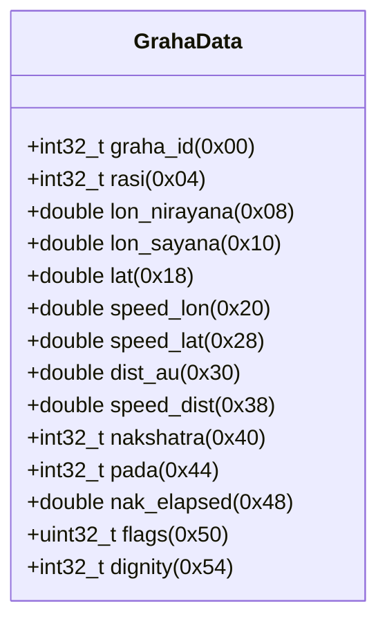
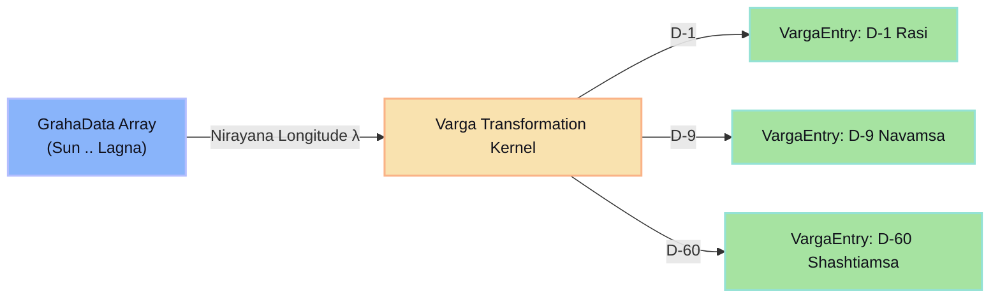

# 🔍 [ANALYSIS] Memory Layout & Astrological Data Structures
> **Target:** Jagannatha Hora (Borland C++ Builder PE32)  
> **Framework:** REA / Radare2 (`r2`)  
> **Focus:** Structural reconstruction of `GrahaData`, `BhavaData`, and `VargaFactors`

---

## 📑 Table of Contents
- [1. Compiler Memory Profile & Alignment](#1-compiler-memory-profile--alignment)
- [2. Planetary Positions Structure (`GrahaData`)](#2-planetary-positions-structure-grahadata)
  - [2.1 Byte Offset & Field Mapping](#21-byte-offset--field-mapping)
  - [2.2 Visual Memory Layout](#22-visual-memory-layout)
  - [2.3 Radare2 Struct Format String (`pf`)](#23-radare2-struct-format-string-pf)
  - [2.4 C++ Reconstructed Definition](#24-c-reconstructed-definition)
  - [2.5 Bitfield Flags (`uint32_t flags`)](#25-bitfield-flags-uint32_t-flags)
- [3. House Cusps Structure (`BhavaData`)](#3-house-cusps-structure-bhavadata)
  - [3.1 Offset & Alignment Specification](#31-offset--alignment-specification)
  - [3.2 C++ Definition & House Systems](#32-c-definition--house-systems)
  - [3.3 Radare2 Format (`pf.Bhava`)](#33-radare2-format-pfbhava)
- [4. Divisional Factors Structure (`VargaFactors` & Tables)](#4-divisional-factors-structure-vargafactors--tables)
  - [4.1 Shodashavarga Factor Matrix](#41-shodashavarga-factor-matrix)
  - [4.2 Harmonic Mapping & Memory Layout](#42-harmonic-mapping--memory-layout)
  - [4.3 C++ Definition](#43-c-definition)

---

## 1. Compiler Memory Profile & Alignment

Borland C++ Builder (v5.0/6.0) targets the IA-32 (x86 32-bit) architecture. The compiler uses `#pragma pack(8)` or `#pragma pack(4)` depending on compiler optimization flags:
- **Floating-point types:** `double` is standard IEEE 754 64-bit (8 bytes), aligned on 8-byte or 4-byte boundaries. Extended precision `long double` is 80-bit (10 bytes, often padded to 12 bytes).
- **Integral types:** `int` and `long` are 32-bit signed integers (4 bytes), aligned on 4 bytes. `short` is 16-bit (2 bytes).
- **Booleans:** `bool` is 1 byte, padded according to the member alignment.
- **Calling Convention:** Borland `__fastcall` passes up to three arguments in `EAX`, `EDX`, `ECX`.

---

## 2. Planetary Positions Structure (`GrahaData`)

In Jagannatha Hora, each celestial body (Sun, Moon, Mars, Mercury, Jupiter, Venus, Saturn, Rahu, Ketu, Uranus, Neptune, Pluto, Ascendant/Lagna, plus Upagrahas like Mandi/Gulika) is stored in a contiguous array of `GrahaData` structs.

### 2.1 Byte Offset & Field Mapping

| Offset (Hex) | Offset (Dec) | Size (Bytes) | Type | Member Name | Description |
| :--- | :--- | :--- | :--- | :--- | :--- |
| `+0x00` | 0 | 4 | `int32_t` | `graha_id` | Planet ID (0=Sun, 1=Moon, ..., 7=Rahu, 8=Ketu) |
| `+0x04` | 4 | 4 | `int32_t` | `rasi` | Zodiac sign index (0=Mesha/Aries .. 11=Meena/Pisces) |
| `+0x08` | 8 | 8 | `double` | `lon_nirayana` | Sidereal Longitude ($0.0^\circ \le \lambda < 360.0^\circ$) |
| `+0x10` | 16 | 8 | `double` | `lon_sayana` | Tropical Longitude ($0.0^\circ \le \lambda < 360.0^\circ$) |
| `+0x18` | 24 | 8 | `double` | `lat` | Ecliptic Latitude ($\beta$, degrees) |
| `+0x20` | 32 | 8 | `double` | `speed_lon` | Daily motion / velocity in longitude ($^\circ/\text{day}$) |
| `+0x28` | 40 | 8 | `double` | `speed_lat` | Daily motion in latitude ($^\circ/\text{day}$) |
| `+0x30` | 48 | 8 | `double` | `dist_au` | Distance from Earth (Astronomical Units) |
| `+0x38` | 56 | 8 | `double` | `speed_dist` | Distance rate of change ($\text{AU}/\text{day}$) |
| `+0x40` | 64 | 4 | `int32_t` | `nakshatra` | Nakshatra index ($0 \le N \le 26$, Ashwini..Revati) |
| `+0x44` | 68 | 4 | `int32_t` | `pada` | Nakshatra Pada ($1 \le P \le 4$) |
| `+0x48` | 72 | 8 | `double` | `nak_elapsed` | Percentage/degree elapsed within current Nakshatra |
| `+0x50` | 80 | 4 | `uint32_t` | `flags` | Bitfield: Retrograde, Combust, Stationary, etc. |
| `+0x54` | 84 | 4 | `int32_t` | `dignity` | Planetary dignity (Uccha, Neecha, Moolatrikona, etc.) |
| **Total** | | **88 bytes** | (`0x58`) | | Contiguous block per Graha |

### 2.2 Visual Memory Layout



```
+----------------------------------------------------------------------------------------------------+
| 0x00: graha_id (4B) | 0x04: rasi (4B)      | 0x08: lon_nirayana (8B - double)                      |
+---------------------+----------------------+-------------------------------------------------------+
| 0x10: lon_sayana (8B - double)             | 0x18: lat (8B - double)                               |
+--------------------------------------------+-------------------------------------------------------+
| 0x20: speed_lon (8B - double)              | 0x28: speed_lat (8B - double)                          |
+--------------------------------------------+-------------------------------------------------------+
| 0x30: dist_au (8B - double)                | 0x38: speed_dist (8B - double)                         |
+--------------------------------------------+-------------------------------------------------------+
| 0x40: nakshatra (4B)| 0x44: pada (4B)      | 0x48: nak_elapsed (8B - double)                       |
+---------------------+----------------------+-------------------------------------------------------+
| 0x50: flags (4B - bitfield)                | 0x54: dignity (4B - int32)                            |
+----------------------------------------------------------------------------------------------------+
Total Size: 0x58 (88 bytes) per planet
```

### 2.3 Radare2 Struct Format String (`pf`)

In Radare2, define and print the structure directly on memory addresses:

```text
# Define GrahaData format in radare2
[0x00452A10]> "pf.GrahaData i i d d d d d d d i i d x i graha_id rasi lon_nirayana lon_sayana lat speed_lon speed_lat dist_au speed_dist nakshatra pada nak_elapsed flags dignity"

# Inspect the Sun (Graha index 0) at global buffer offset 0x0052F100
[0x00452A10]> pf.GrahaData @ 0x0052F100

# Inspect Moon (Graha index 1) at offset 0x0052F100 + 0x58 = 0x0052F158
[0x00452A10]> pf.GrahaData @ 0x0052F158
```

### 2.4 C++ Reconstructed Definition

```cpp
#pragma pack(push, 4)

enum GrahaId : int32_t {
    GRAHA_SUN     = 0,
    GRAHA_MOON    = 1,
    GRAHA_MARS    = 2,
    GRAHA_MERCURY = 3,
    GRAHA_JUPITER = 4,
    GRAHA_VENUS   = 5,
    GRAHA_SATURN  = 6,
    GRAHA_RAHU    = 7,
    GRAHA_KETU    = 8,
    GRAHA_URANUS  = 9,
    GRAHA_NEPTUNE = 10,
    GRAHA_PLUTO   = 11,
    GRAHA_LAGNA   = 12,
    GRAHA_COUNT   = 13
};

enum PlanetaryDignity : int32_t {
    DIGNITY_UCCHA         = 0, // Exaltation
    DIGNITY_MOOLATRIKONA  = 1, // Root trine
    DIGNITY_SWAKSHETRA    = 2, // Own sign
    DIGNITY_ADHI_MITRA    = 3, // Great friend
    DIGNITY_MITRA         = 4, // Friend
    DIGNITY_SAMA          = 5, // Neutral
    DIGNITY_SHATRU        = 6, // Enemy
    DIGNITY_ADHI_SHATRU   = 7, // Bitter enemy
    DIGNITY_NEECHA        = 8  // Debilitation
};

struct GrahaData {
    int32_t   graha_id;        // +0x00: Planet identification constant
    int32_t   rasi;            // +0x04: Sign index [0..11]
    double    lon_nirayana;    // +0x08: Sidereal longitude in degrees [0..360)
    double    lon_sayana;      // +0x10: Tropical longitude in degrees [0..360)
    double    lat;             // +0x18: Ecliptic latitude in degrees
    double    speed_lon;       // +0x20: Daily longitude speed (deg/day) (< 0 => Retrograde)
    double    speed_lat;       // +0x28: Daily latitude speed (deg/day)
    double    dist_au;         // +0x30: True geocentric distance (AU)
    double    speed_dist;      // +0x38: Daily radial velocity (AU/day)
    int32_t   nakshatra;       // +0x40: Nakshatra index [0..26]
    int32_t   pada;            // +0x44: Pada subdivision [1..4]
    double    nak_elapsed;     // +0x48: Fraction of nakshatra traversed [0.0..1.0]
    uint32_t  flags;           // +0x50: Status flags bitmask
    int32_t   dignity;         // +0x54: Dignity state enumeration
};

#pragma pack(pop)
static_assert(sizeof(GrahaData) == 0x58, "GrahaData size mismatch with Borland binary");
```

### 2.5 Bitfield Flags (`uint32_t flags`)

The `flags` field at offset `+0x50` encodes critical astronomical and Vedic evaluation flags recovered from conditional branches in the binary:

```cpp
#define GRAHA_FLAG_RETROGRADE   (1 << 0) // 0x0001: speed_lon < 0.0 (Vakri)
#define GRAHA_FLAG_COMBUST      (1 << 1) // 0x0002: Within combustion orb of Sun (Asta)
#define GRAHA_FLAG_STATIONARY   (1 << 2) // 0x0004: |speed_lon| < 0.0001
#define GRAHA_FLAG_DECLINING    (1 << 3) // 0x0008: South declination
#define GRAHA_FLAG_EXALTED      (1 << 4) // 0x0010: At or near exaltation point
#define GRAHA_FLAG_DEBILITATED  (1 << 5) // 0x0020: At or near debilitation point
#define GRAHA_FLAG_GRAHA_YUDDHA (1 << 6) // 0x0040: Planetary war (< 1 deg from another taragraha)
#define GRAHA_FLAG_VARGOTTAMA   (1 << 7) // 0x0080: Same sign in Rasi (D-1) and Navamsa (D-9)
```

---

## 3. House Cusps Structure (`BhavaData`)

Jagannatha Hora supports multiple house systems (Bhava Madhya/Chalita per Sripati/Porphyry, Equal House/Vedic 30-degree signs, Placidus, Koch, Regiomontanus).

### 3.1 Offset & Alignment Specification

| Offset (Hex) | Size (Bytes) | Type | Member Name | Description |
| :--- | :--- | :--- | :--- | :--- |
| `+0x00` | 4 | `int32_t` | `house_system` | 0=Equal, 1=Sripati, 2=Placidus, 3=Koch |
| `+0x04` | 4 | `int32_t` | `lagna_rasi` | Sign index of Ascendant [0..11] |
| `+0x08` | 8 | `double` | `ascendant_lon` | Ascendant (Lagna) Nirayana longitude |
| `+0x10` | 8 | `double` | `mc_lon` | Medium Coeli (MC) Nirayana longitude |
| `+0x18` | 8 | `double` | `armc` | Sidereal Time / ARMC (degrees) |
| `+0x20` | 8 | `double` | `vertex_lon` | Vertex longitude |
| `+0x28` | 96 | `double[12]` | `cusps` | House centers / Bhava Madhyas (12 $\times$ 8B) |
| `+0x88` | 96 | `double[12]` | `sandhis` | House junctions / Bhava Sandhis (12 $\times$ 8B) |
| `+0xE8` | 48 | `int32_t[12]` | `cusp_rasi` | Sign index for each house cusp (12 $\times$ 4B) |
| `+0x118` | 48 | `int32_t[12]` | `cusp_nakshatra`| Nakshatra index for each house (12 $\times$ 4B) |
| **Total** | **328 bytes** | (`0x148`) | | Complete Bhava evaluation structure |

### 3.2 C++ Definition & House Systems

```cpp
#pragma pack(push, 4)

enum HouseSystemId : int32_t {
    HOUSE_SYSTEM_EQUAL_RASI = 0, // Vedic traditional (Sign = House)
    HOUSE_SYSTEM_SRIPATI    = 1, // Sripati / Porphyry with Bhava Sandhis
    HOUSE_SYSTEM_PLACIDUS   = 2, // Modern Western / KP System
    HOUSE_SYSTEM_KOCH       = 3, // Koch
    HOUSE_SYSTEM_CAMPANUS   = 4,
    HOUSE_SYSTEM_REGIOMONT  = 5
};

struct BhavaData {
    int32_t  house_system;       // +0x00: Active calculation method
    int32_t  lagna_rasi;          // +0x04: Sign of the 1st House cusp
    double   ascendant_lon;       // +0x08: Lagna longitude in degrees
    double   mc_lon;              // +0x10: Midheaven / 10th cusp longitude
    double   armc;                // +0x18: Right Ascension of Midheaven
    double   vertex_lon;          // +0x20: Vertex longitude
    double   cusps[12];           // +0x28: Nirayana longitudes of 12 Bhava Madhyas
    double   sandhis[12];         // +0x88: Junction points separating bhavas
    int32_t  cusp_rasi[12];       // +0xE8: Zodiac signs occupied by the 12 cusps
    int32_t  cusp_nakshatra[12];  // +0x118: Nakshatras occupied by the 12 cusps
};

#pragma pack(pop)
static_assert(sizeof(BhavaData) == 0x148, "BhavaData struct size mismatch");
```

### 3.3 Radare2 Format (`pf.Bhava`)

```text
[0x00452A10]> "pf.BhavaData i i d d d d [12]d [12]d [12]i [12]i house_system lagna_rasi ascendant_lon mc_lon armc vertex_lon cusps sandhis cusp_rasi cusp_nakshatra"
```

---

## 4. Divisional Factors Structure (`VargaFactors` & Tables)

In Vedic astrology, the natal chart (D-1) is subdivided into harmonic divisional charts (*Shodashavargas* and higher, up to D-60).

### 4.1 Shodashavarga Factor Matrix

| Varga Code | Division ($N$) | Name | Spiritual / Material Signification |
| :--- | :--- | :--- | :--- |
| **D-1** | 1 | Rasi | Physical existence, body, overall life |
| **D-2** | 2 | Hora | Wealth, financial prosperity, Sun/Moon polarity |
| **D-3** | 3 | Drekkana | Siblings, courage, motivation, third-house matters |
| **D-4** | 4 | Chaturthamsa | Fixed assets, properties, fortune, home |
| **D-7** | 7 | Saptamsa | Children, progeny, grandchildren |
| **D-9** | 9 | Navamsa | Dharma, spouse, inner potential, soul evolution |
| **D-10** | 10 | Dasamsa | Career, vocation, public status, profession |
| **D-12** | 12 | Dvadasamsa | Parents, ancestral heritage, past lives |
| **D-16** | 16 | Shodashamsa | Vehicles, luxuries, inner happiness (Sukha) |
| **D-20** | 20 | Vimsamsa | Spiritual practices, devotion, upasana |
| **D-24** | 24 | Chaturvimsamsa | Higher knowledge, learning, academic acumen |
| **D-27** | 27 | Nakshatramsa | Strengths, weaknesses, subconscious conditioning |
| **D-30** | 30 | Trimsamsa | Misfortunes, evils, moral character, health |
| **D-40** | 40 | Khavedamsa | Auspicious and inauspicious events |
| **D-45** | 45 | Akshavedamsa | General well-being, all facets of karma |
| **D-60** | 60 | Shashtiamsa | Root past-life karma, ultimate differentiator |

### 4.2 Harmonic Mapping & Memory Layout

In the binary's memory heap, Jagannatha Hora allocates a flattened 2D matrix representing the divisional coordinates for all planets across all configured Vargas:

```
[Graha Index (0..12)][Varga Index (0..15)] -> VargaEntry
```



### 4.3 C++ Definition

```cpp
#pragma pack(push, 4)

struct VargaEntry {
    int32_t division_factor;  // Division number N (e.g. 9 for Navamsa)
    int32_t rasi;             // Calculated divisional sign [0..11]
    double  degree_in_rasi;   // Normalized coordinate within varga sign [0.0..30.0)
    double  harmonic_lon;     // Total divisional longitude: rasi * 30.0 + degree_in_rasi
    int32_t lord_graha_id;    // Ruler of the calculated varga sign
};

// Shodashavarga planet container (16 major divisions per planet)
struct GrahaVargaProfile {
    int32_t     graha_id;
    VargaEntry  vargas[16];   // Array indexed by standard Shodashavarga slot
};

// Complete matrix for all 13 celestial points
struct VargaMatrix {
    GrahaVargaProfile planets[13];
};

#pragma pack(pop)
```

---
*Radare2 Memory mapping verified against Win32 Borland C++ Builder 5.0 Object Structure standards.*
