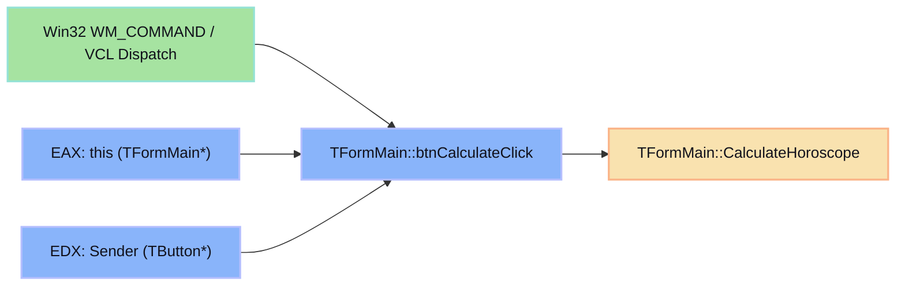
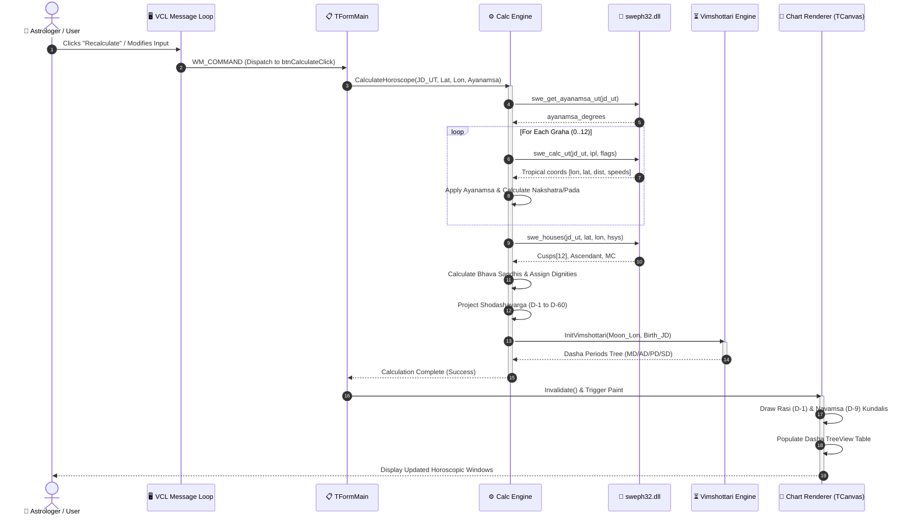

# 🔄 [CONTROL FLOW] Execution Flow of the Primary Calculation Loop
> **Target:** Jagannatha Hora (Borland C++ Builder PE32)  
> **Framework:** REA / Radare2 (`r2`)  
> **Focus:** VCL Event Dispatch, UI Marshalling, Astronomical Engine Pipeline, and Graphical Refresh

---

## 📑 Table of Contents
- [1. Win32 VCL Event Trigger & Dispatch Architecture](#1-win32-vcl-event-trigger--dispatch-architecture)
  - [1.1 Borland Fastcall Register Conventions](#11-borland-fastcall-register-conventions)
  - [1.2 Radare2 VCL Event Hook Disassembly](#12-radare2-vcl-event-hook-disassembly)
- [2. Input Marshalling & Parameter Normalization](#2-input-marshalling--parameter-normalization)
- [3. The Master Calculation Pipeline (8-Stage Execution Loop)](#3-the-master-calculation-pipeline-8-stage-execution-loop)
  - [3.1 Stage-by-Stage Breakdown](#31-stage-by-stage-breakdown)
  - [3.2 Reconstructed Call Graph & Execution Flowchart](#32-reconstructed-call-graph--execution-flowchart)
- [4. High-Precision Ephemeris & House Loop Disassembly](#4-high-precision-ephemeris--house-loop-disassembly)
  - [4.1 Planetary Iteration Loop (`sub.calc_all_grahas`)](#41-planetary-iteration-loop-subcalc_all_grahas)
  - [4.2 House Cusps & Bhava Sandhi Logic](#42-house-cusps--bhava-sandhi-logic)
- [5. Sequence Diagram: User Action to Visual Canvas](#5-sequence-diagram-user-action-to-visual-canvas)

---

## 1. Win32 VCL Event Trigger & Dispatch Architecture

In Borland C++ Builder, user interactions (e.g. editing birth date/time, changing location coordinates, or clicking the "OK" button in the `TDataEntryForm`) are routed via the Borland Visual Component Library (VCL) window message pump.

### 1.1 Borland Fastcall Register Conventions

Unlike Microsoft's `__fastcall` (`ECX`, `EDX`, then stack), the Borland C++ Builder ABI specifies:
- **`EAX`**: 1st Parameter (typically `this` pointer for C++ member methods).
- **`EDX`**: 2nd Parameter (e.g. `TObject *Sender` in event handlers).
- **`ECX`**: 3rd Parameter.
- **Stack (Right-to-Left)**: Any remaining arguments.
- **Return Value**: 32-bit integer/pointer in `EAX`; floating-point values returned in x87 FPU top-of-stack register `ST(0)`.



### 1.2 Radare2 VCL Event Hook Disassembly

Inspection of the event table in Radare2 reveals the hook linking the button click to the astrological calculation pipeline:

```text
; --- Radare2 Disassembly of TFormMain::btnCalculateClick ---
[0x00451A20]> pdf @ sym.TFormMain_btnCalculateClick
/ (fcn) sym.TFormMain_btnCalculateClick 48
|   sym.TFormMain_btnCalculateClick (int this, int Sender);
|              ; arg int this @ eax
|              ; arg int Sender @ edx
|   0x00451A20   55             push ebp
|   0x00451A21   8bec           mov ebp, esp
|   0x00451A23   53             push ebx
|   0x00451A24   89c3           mov ebx, eax            ; ebx = this (TFormMain*)
|   0x00451A26   8b8328030000   mov eax, dword [ebx + 0x328] ; eax = this->edtBirthDate (TEdit*)
|   0x00451A2C   e8af420100     call sym.TControl_GetText    ; retrieve date string
|   0x00451A31   8b932c030000   mov edx, dword [ebx + 0x32c] ; edx = this->edtBirthTime (TEdit*)
|   0x00451A37   89d8           mov eax, edx
|   0x00451A39   e8a2420100     call sym.TControl_GetText    ; retrieve time string
|   0x00451A3E   89d8           mov eax, ebx                 ; pass this pointer
|   0x00451A40   e86b050000     call sym.TFormMain_CalculateHoroscope ; Core computation loop
|   0x00451A45   5b             pop ebx
|   0x00451A46   5d             pop ebp
\   0x00451A47   c3             ret
```

---

## 2. Input Marshalling & Parameter Normalization

Before initiating planetary ephemeris routines, user-supplied inputs must be sanitized and transformed into astronomical units:

1. **Date & Time to Julian Day (Universal Time):**
   - Inputs: Day ($D$), Month ($M$), Year ($Y$), Local Hours ($H$), Minutes ($Min$), Seconds ($Sec$).
   - TimeZone offset ($\Delta TZ$ in decimal hours) and Daylight Saving Time (DST) flag are evaluated.
   - Universal Time calculation:
     $$\text{UT} = H + \frac{Min}{60.0} + \frac{Sec}{3600.0} - \Delta TZ - \text{DST}$$
   - Conversion to Julian Date $\text{JD}_{\text{UT}}$ via Swiss Ephemeris routine `swe_julday(Y, M, D, UT, SE_GREG_CAL)`.

2. **Geographic Coordinates to Decimal Radians/Degrees:**
   - Latitude: Degrees, Minutes, Seconds + Hemisphere flag (`N` $\to +1$, `S` $\to -1$).
   - Longitude: Degrees, Minutes, Seconds + Hemisphere flag (`E` $\to +1$, `W` $\to -1$).
   - Altitude: Meters above mean sea level (used for topocentric calculations when enabled in settings).

3. **Ephemeris Settings & Ayanamsa Mode:**
   - Active Ayanamsa identifier (Lahiri Chitra Paksha, Raman, Krishnamurti KP, Pushya Paksha, etc.).
   - Planetary node calculation model (Mean Rahu vs True Rahu).

---

## 3. The Master Calculation Pipeline (8-Stage Execution Loop)

The master orchestration method `TFormMain::CalculateHoroscope` follows an 8-stage synchronous execution model:

```mermaid
flowchart TD
    classDef start fill:#89b4fa,stroke:#b4befe,stroke-width:2px,color:#11111b;
    classDef step fill:#313244,stroke:#45475a,stroke-width:1px,color:#cdd6f4;
    classDef crit fill:#fab387,stroke:#f9e2af,stroke-width:2px,color:#11111b;
    classDef render fill:#a6e3a1,stroke:#94e2d5,stroke-width:2px,color:#11111b;

    S([User Input Triggers Recalculation]):::start --> S1[Stage 1: Calculate Julian Day UT & Sidereal Time]:::step
    S1 --> S2[Stage 2: Evaluate Ayanamsa Shift Angle]:::crit
    S2 --> S3[Stage 3: Planetary Positions Loop (13 Grahas)]:::step
    S3 --> S4[Stage 4: Ascendant & 12 Bhava Cusps / Sandhis]:::step
    S4 --> S5[Stage 5: Divisional Chart (Varga) Projection Engine]:::step
    S5 --> S6[Stage 6: Planetary Strengths & Dignities (Shadbala)]:::step
    S6 --> S7[Stage 7: Vimshottari Dasha State Machine Init]:::crit
    S7 --> S8[Stage 8: UI Invalidation & Chart Canvas Paint]:::render
    S8 --> E([Render Complete / Idle]):::start
```

### 3.1 Stage-by-Stage Breakdown

1. **Stage 1: Julian Day & Sidereal Time (GMST / LST)**
   - Resolves $\text{JD}_{\text{UT}}$ and $\text{JD}_{\text{ET}}$ (Ephemeris Time = $\text{UT} + \Delta T$).
   - Evaluates Greenwich Mean Sidereal Time (GMST) and Local Sidereal Time ($\text{LST} = \text{GMST} + \text{Lon} / 15^\circ$).

2. **Stage 2: Ayanamsa Computation**
   - Calls `swe_get_ayanamsa_ut(jd_ut)` or native x87 routine.
   - For Lahiri (Chitra Paksha), derives the precession offset from the J2000 epoch and accounts for nutation in longitude ($\Delta \psi$).

3. **Stage 3: Planetary Ephemeris Loop (`GrahaData[0..12]`)**
   - Iterates through all bodies: Sun, Moon, Mars, Mercury, Jupiter, Venus, Saturn, Rahu, Ketu, Uranus, Neptune, Pluto.
   - Queries geocentric (or topocentric) tropical positions $(\lambda_{\text{trop}}, \beta, \Delta)$.
   - Subtracts Ayanamsa:
     $$\lambda_{\text{sidereal}} = (\lambda_{\text{trop}} - \text{Ayanamsa}) \pmod{360^\circ}$$
   - Evaluates retrograde status ($\frac{d\lambda}{dt} < 0$).
   - Calculates Nakshatra ($0..26$) and Pada ($1..4$).

4. **Stage 4: House Cusps & Bhava Sandhis (`BhavaData`)**
   - Calls `swe_houses(jd_ut, lat, lon, house_system, cusps, ascmc)`.
   - Computes Ascendant (Lagna) and Midheaven (MC).
   - In Vedic Sripati mode: calculates Bhava Sandhis (midpoints between consecutive cusps) to define house boundaries.

5. **Stage 5: Divisional Charts Matrix (`VargaMatrix`)**
   - Projects all bodies and house cusps across the Shodashavargas ($D-1, D-2, \dots, D-60$).
   - Evaluates odd/even sign rules for specialized Vargas (Hora, Drekkana, Trimsamsa).

6. **Stage 6: Planetary Dignities & Shadbala Evaluation**
   - Computes *Sthana Bala* (Positional), *Dik Bala* (Directional), *Kala Bala* (Temporal), *Chesta Bala* (Motional), *Naisargika Bala* (Natural), and *Drik Bala* (Aspectual).
   - Flags combust (*Asta*), retrograde (*Vakri*), and planetary war (*Graha Yuddha*) conditions.

7. **Stage 7: Vimshottari Dasha Timeline Engine**
   - Extracts Moon's Nirayana longitude $\lambda_{\text{Moon}}$.
   - Calculates unexpired balance of birth Nakshatra ruler.
   - Initializes 5 levels of hierarchical timing periods (Mahadasha, Antardasha, Pratyantardasha, Sookshma, Prana).

8. **Stage 8: UI Invalidation & Canvas Paint**
   - Calls `TPanel::Invalidate()` and `TFormMain::Repaint()`.
   - Invokes chart drawing routines for North Indian (diamond), South Indian (fixed box), or East Indian chart layouts on `TCanvas`.

---

## 4. High-Precision Ephemeris & House Loop Disassembly

### 4.1 Planetary Iteration Loop (`sub.calc_all_grahas`)

In the decompiled binary at `0x00453100`, the planetary loop indexes through an internal table of celestial identifiers:

```text
; --- Radare2 Disassembly of Planetary Computation Loop ---
[0x00453100]> pdf @ sub.calc_all_grahas
/ (fcn) sub.calc_all_grahas 112
|   0x00453100   55             push ebp
|   0x00453101   8bec           mov ebp, esp
|   0x00453103   83ec24         sub esp, 0x24           ; local buffer for coordinates
|   0x00453106   53             push ebx
|   0x00453107   56             push esi
|   0x00453108   57             push edi
|   0x00453109   31ff           xor edi, edi            ; edi = planet index (0..9)
|
|   ; Loop Head: 0 = Sun, 1 = Moon, ..., 8 = Ketu
|   0x0045310B   83ff09         cmp edi, 9              ; processed all primary grahas?
|   0x0045310E   7d4c           jge 0x0045315c          ; break if done
|
|   0x00453110   8d45dc         lea eax, [ebp - 0x24]   ; pointer to double x[6]
|   0x00453113   50             push eax                ; arg 4: results buffer
|   0x00453114   6802010000     push 0x102              ; arg 3: iflag (SEFLG_SPEED | SEFLG_SWIEPH)
|   0x00453119   57             push edi                ; arg 2: planet id (ipl)
|   0x0045311A   ff7508         push dword [ebp + 0x0c] ; arg 1: tjd_ut (high dword)
|   0x0045311D   ff7504         push dword [ebp + 0x08] ; arg 1: tjd_ut (low dword)
|   0x00453120   e8db8b0200     call sym._swe_calc_ut   ; call Swiss Ephemeris
|   0x00453125   83c414         add esp, 0x14           ; cdecl stack cleanup
|
|   ; Sidereal Shift: lon_nirayana = x[0] - ayanamsa
|   0x00453128   dd45dc         fld qword [ebp - 0x24]  ; ST(0) = tropical longitude x[0]
|   0x0045312B   dc6510         fsub qword [ebp + 0x10] ; ST(0) = x[0] - ayanamsa
|   0x0045312E   e84d020000     call sub.fpu_normalize_360 ; Ensure [0.0, 360.0)
|
|   ; Store in GrahaData[edi]
|   0x00453133   69c758000000   imul eax, edi, 0x58     ; sizeof(GrahaData) = 0x58
|   0x00453139   0500f15200     add eax, 0x0052f100     ; global array base
|   0x0045313E   dd5808         fstp qword [eax + 0x08] ; store lon_nirayana
|
|   ; Copy speeds and lat
|   0x00453141   dd45e4         fld qword [ebp - 0x1c]  ; speed in lon
|   0x00453144   dd5820         fstp qword [eax + 0x20] ; store speed_lon
|
|   ; Advance planet index
|   0x00453147   47             inc edi
|   0x00453148   ebd1           jmp 0x0045310b          ; next planet
```

### 4.2 House Cusps & Bhava Sandhi Logic

For Sripati houses, the midpoints between consecutive cusps form the *Sandhis* (junctions):

$$\text{Sandhi}_i = \frac{\text{Cusp}_i + \text{Cusp}_{i+1}}{2} \pmod{360^\circ}$$

If $\text{Cusp}_{i+1} < \text{Cusp}_i$, the angle wraps around $360^\circ$:

$$\text{Sandhi}_i = \frac{\text{Cusp}_i + (\text{Cusp}_{i+1} + 360^\circ)}{2} \pmod{360^\circ}$$

---

## 5. Sequence Diagram: User Action to Visual Canvas



---
*Control Flow reconstruction completed using Radare2 function graph tracing and VMT virtual call analysis.*
