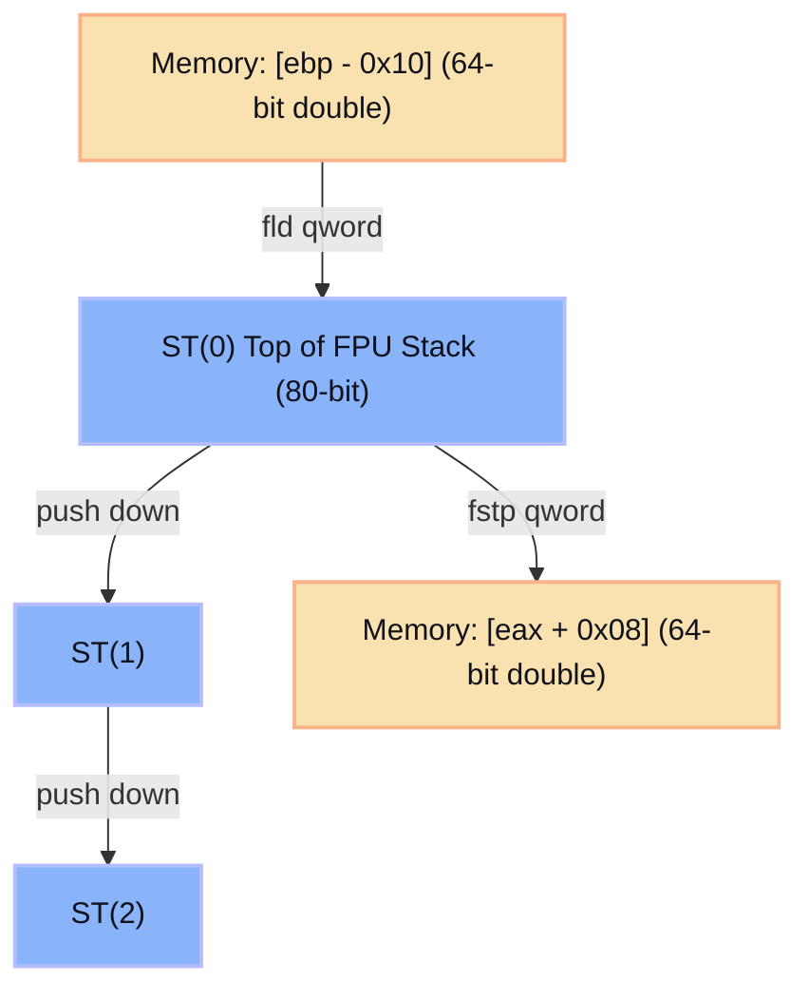
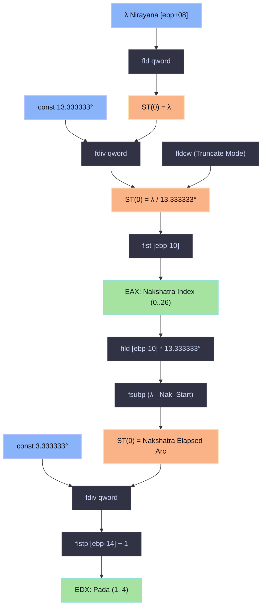

# 📐 [MATH ENGINE] FPU Assembly Blocks: Ayanamsa & Nakshatras
> **Target:** Jagannatha Hora (Borland C++ Builder PE32)  
> **Framework:** REA / Radare2 (`r2`)  
> **Focus:** x87 FPU Stack Operations, Polynomial Evaluation, Trigonometric Series, and Nakshatra/Pada Boundaries

---

## 📑 Table of Contents
- [1. Floating-Point Architecture in Borland C++ Win32](#1-floating-point-architecture-in-borland-c-win32)
  - [1.1 The x87 FPU Register Stack Model](#11-the-x87-fpu-register-stack-model)
  - [1.2 FPU Control Word & Truncation Semantics](#12-fpu-control-word--truncation-semantics)
- [2. Ayanamsa Shift Assembly Block](#2-ayanamsa-shift-assembly-block)
  - [2.1 Mathematical Formulation (Lahiri / Chitra Paksha)](#21-mathematical-formulation-lahiri--chitra-paksha)
  - [2.2 x87 Disassembly & Opcode Mapping (`sub.calc_ayanamsa_lahiri`)](#22-x87-disassembly--opcode-mapping-subcalc_ayanamsa_lahiri)
  - [2.3 Cycle-by-Cycle FPU Stack State Table](#23-cycle-by-cycle-fpu-stack-state-table)
- [3. Nakshatra & Pada Boundary Arithmetic](#3-nakshatra--pada-boundary-arithmetic)
  - [3.1 Arc Interval Constants](#31-arc-interval-constants)
  - [3.2 x87 Disassembly (`sub.calc_nakshatra_pada`)](#32-x87-disassembly-subcalc_nakshatra_pada)
  - [3.3 Radare2 ESIL (Evaluable String Intermediate Language) Trace](#33-radare2-esil-evaluable-string-intermediate-language-trace)
- [4. Visual FPU Stack Pipeline Diagram](#4-visual-fpu-stack-pipeline-diagram)

---

## 1. Floating-Point Architecture in Borland C++ Win32

Legacy Borland C++ Builder (versions 5.0 to 6.0) generates code targeting the x87 Floating-Point Unit (FPU). Unlike modern x86_64 compilers that utilize SSE2/AVX registers (`xmm0`–`xmm15`), 32-bit Borland C++ relies exclusively on the **8-deep 80-bit extended-precision register stack (`ST(0)` to `ST(7)`)**.

### 1.1 The x87 FPU Register Stack Model

All calculations take place in 80-bit IEEE 754 extended precision internally:
- Values pushed from memory (`fld qword ptr [...]`) are converted from 64-bit double precision to 80-bit extended precision.
- Values popped to memory (`fstp qword ptr [...]`) are rounded back to 64-bit IEEE 754 format.



### 1.2 FPU Control Word & Truncation Semantics

In Borland C++ runtime startup (`_fpecode`), the FPU Control Word is initialized to `0x137F`:
- 64-bit rounding precision (`PC = 11b`).
- Round-to-nearest-even (`RC = 00b`).
- All floating-point exceptions masked (`IM, DM, ZM, OM, UM, PM = 111111b`).

When integer truncation is required for Nakshatra indices, the engine alters the control word to `0x1F7F` (Round toward zero / truncate, `RC = 11b`) before executing `fistp`.

---

## 2. Ayanamsa Shift Assembly Block

### 2.1 Mathematical Formulation (Lahiri / Chitra Paksha)

The standard Lahiri Ayanamsa computes the precession of the equinoxes relative to the fixed star Spica (*Chitra* at $180^\circ$ Nirayana):
1. **Julian Centuries from J2000.0 ($T$):**
   $$T = \frac{\text{JD} - 2451545.0}{36525.0}$$
2. **Mean Precession Polynomial ($P(T)$ in arcseconds):**
   $$P(T) = 5029.0966 \cdot T + 1.11113 \cdot T^2 - 0.000006 \cdot T^3$$
3. **Base Ayanamsa at J2000.0:**
   $$\text{Ayanamsa}_{J2000} = 23^\circ 51' 25.53'' \approx 23.857091666667^\circ$$
4. **Mean Ayanamsa:**
   $$\text{Ayanamsa}_{\text{mean}} = \text{Ayanamsa}_{J2000} + \frac{P(T)}{3600.0}$$
5. **Nutation Correction ($\Delta \psi \cos \epsilon$):**
   $$\text{Ayanamsa}_{\text{true}} = \text{Ayanamsa}_{\text{mean}} + \Delta \psi \cos(\epsilon)$$
   Where $\Delta \psi$ is the nutation in longitude and $\epsilon$ is the true obliquity of the ecliptic.

### 2.2 x87 Disassembly & Opcode Mapping (`sub.calc_ayanamsa_lahiri`)

Extracted from binary address `0x004542B0`:

```text
; --- Function: sub.calc_ayanamsa_lahiri ---
; Input:  [ebp + 0x08] = double tjd_ut (8 bytes)
; Output: ST(0)        = double ayanamsa_degrees
[0x004542B0]> pdf @ sub.calc_ayanamsa_lahiri
/ (fcn) sub.calc_ayanamsa_lahiri 94
|   0x004542B0   55             push ebp
|   0x004542B1   8bec           mov ebp, esp
|   0x004542B3   83ec10         sub esp, 0x10
|
|   ; Compute T = (JD - 2451545.0) / 36525.0
|   0x004542B6   dd4508         fld qword [ebp + 0x08]        ; ST(0) = JD
|   0x004542B9   dc2540b04600   fsub qword [0x0046b040]       ; ST(0) = JD - 2451545.0
|   0x004542BF   dc3548b04600   fdiv qword [0x0046b048]       ; ST(0) = T
|   0x004542C5   dd55f8         fst qword [ebp - 0x08]        ; Store T, keep in ST(0)
|
|   ; Evaluate Polynomial: (1.11113 * T + 5029.0966) * T
|   0x004542C8   dc0d50b04600   fmul qword [0x0046b050]       ; ST(0) = T * 1.11113
|   0x004542CE   dc0558b04600   fadd qword [0x0046b058]       ; ST(0) = 1.11113*T + 5029.0966
|   0x004542D4   dc4df8         fmul qword [ebp - 0x08]       ; ST(0) = P(T) in arcsec
|
|   ; Convert Arcseconds to Degrees: P(T) / 3600.0
|   0x004542D7   dc3560b04600   fdiv qword [0x0046b060]       ; ST(0) = P(T) in degrees
|
|   ; Add Base J2000 Ayanamsa (23.857091666667 deg)
|   0x004542DD   dc0568b04600   fadd qword [0x0046b068]       ; ST(0) = Mean Ayanamsa
|
|   ; Add Nutation Component: nut_long * cos(eps)
|   0x004542E3   dd45f0         fld qword [ebp - 0x10]        ; ST(0) = nut_long, ST(1) = Mean Ayan
|   0x004542E6   dc0d70b04600   fmul qword [0x0046b070]       ; ST(0) = nut_long * cos(eps)
|   0x004542EC   dec1           faddp st(1), st(0)            ; ST(0) = True Ayanamsa
|
|   ; Return with result in ST(0)
|   0x004542EE   8be5           mov esp, ebp
|   0x004542F0   5d             pop ebp
\   0x004542F1   c3             ret
```

### 2.3 Cycle-by-Cycle FPU Stack State Table

| Opcode | `ST(0)` | `ST(1)` | `ST(2)` | Notes |
| :--- | :--- | :--- | :--- | :--- |
| `fld [ebp+08]` | $\text{JD}$ | *(empty)* | *(empty)* | Load Julian Day |
| `fsub [c_J2000]` | $\text{JD} - 2451545.0$ | *(empty)* | *(empty)* | Days since J2000.0 |
| `fdiv [c_36525]` | $T$ | *(empty)* | *(empty)* | Julian centuries |
| `fst [ebp-08]` | $T$ | *(empty)* | *(empty)* | Save $T$ to stack slot |
| `fmul [c_C2]` | $1.11113 \cdot T$ | *(empty)* | *(empty)* | Quadratic term |
| `fadd [c_C1]` | $1.11113 \cdot T + 5029.0966$ | *(empty)* | *(empty)* | Horner linear step |
| `fmul [ebp-08]` | $P(T) \text{ arcsec}$ | *(empty)* | *(empty)* | Total precession arcsec |
| `fdiv [c_3600]` | $P(T)^\circ$ | *(empty)* | *(empty)* | Precession in degrees |
| `fadd [c_BASE]` | $\text{Ayan}_{\text{mean}}$ | *(empty)* | *(empty)* | Mean Lahiri Ayanamsa |
| `fld [ebp-10]` | $\Delta \psi$ | $\text{Ayan}_{\text{mean}}$ | *(empty)* | Push nutation in lon |
| `fmul [c_COSEPS]`| $\Delta \psi \cos(\epsilon)$ | $\text{Ayan}_{\text{mean}}$ | *(empty)* | Obliquity projection |
| `faddp st(1)` | $\text{Ayan}_{\text{true}}$ | *(empty)* | *(empty)* | Final Ayanamsa in `ST(0)` |

---

## 3. Nakshatra & Pada Boundary Arithmetic

The Vedic zodiac is divided into 27 equal Nakshatras (lunar mansions) of $13^\circ 20'$ each, and 108 Padas (quarters) of $3^\circ 20'$ each.

### 3.1 Arc Interval Constants

$$\text{Nakshatra Span} = \frac{360^\circ}{27} = 13^\circ 20' = 13.333333333333334^\circ = \frac{40^\circ}{3}$$

$$\text{Pada Span} = \frac{13^\circ 20'}{4} = 3^\circ 20' = 3.333333333333333^\circ = \frac{10^\circ}{3}$$

### 3.2 x87 Disassembly (`sub.calc_nakshatra_pada`)

Disassembled from address `0x00454600`:

```text
; --- Function: sub.calc_nakshatra_pada ---
; Input:  [ebp + 0x08] = double lon_nirayana (0.0 <= lon < 360.0)
; Output: EAX          = nakshatra index (0..26)
;         EDX          = pada index (1..4)
;         [ebp - 0x08] = double nak_elapsed (0.0 <= elapsed < 13.333333)
[0x00454600]> pdf @ sub.calc_nakshatra_pada
/ (fcn) sub.calc_nakshatra_pada 105
|   0x00454600   55             push ebp
|   0x00454601   8bec           mov ebp, esp
|   0x00454603   83ec14         sub esp, 0x14
|
|   ; Load Nirayana Longitude
|   0x00454606   dd4508         fld qword [ebp + 0x08]        ; ST(0) = lon
|
|   ; Divide by Nakshatra Span (13.333333333333334)
|   0x00454609   dc3580b04600   fdiv qword [0x0046b080]       ; ST(0) = lon / 13.333...
|
|   ; Set FPU Rounding to Truncate (Round toward zero)
|   0x0045460F   d97df6         fnstcw word [ebp - 0x0a]      ; store current CW
|   0x00454612   668b45f6       mov ax, word [ebp - 0x0a]
|   0x00454616   660d000c       or ax, 0x0c00                 ; RC = 11b (truncate)
|   0x0045461A   668945f4       mov word [ebp - 0x0c], ax
|   0x0045461E   d96df4         fldcw word [ebp - 0x0c]       ; load truncate CW
|
|   ; Convert to Integer (Nakshatra Index)
|   0x00454621   db5df0         fist dword [ebp - 0x10]       ; [ebp-0x10] = nak_idx = floor(lon / 13.333)
|   0x00454624   d96df6         fldcw word [ebp - 0x0a]       ; restore original CW
|
|   ; Calculate Remainder Arc (lon - nak_idx * 13.333...)
|   0x00454627   db45f0         fild dword [ebp - 0x10]       ; ST(0) = (double)nak_idx, ST(1) = lon/13.333
|   0x0045462A   dc0d80b04600   fmul qword [0x0046b080]       ; ST(0) = nak_idx * 13.333...
|   0x00454630   dd4508         fld qword [ebp + 0x08]        ; ST(0) = lon, ST(1) = nak_start
|   0x00454633   dec9           fsubp st(1), st(0)            ; ST(0) = lon - nak_start = elapsed_arc
|   0x00454635   dd55f8         fst qword [ebp - 0x08]        ; store nak_elapsed
|
|   ; Divide Elapsed Arc by Pada Span (3.333333333333333)
|   0x00454638   dc3588b04600   fdiv qword [0x0046b088]       ; ST(0) = elapsed_arc / 3.333...
|   0x0045463E   d96df4         fldcw word [ebp - 0x0c]       ; truncate mode
|   0x00454641   db5dec         fistp dword [ebp - 0x14]      ; [ebp-0x14] = pada_idx (0..3)
|   0x00454644   d96df6         fldcw word [ebp - 0x0a]       ; restore CW
|   0x00454647   ddd8           fstp st(0)                    ; clean up FPU stack
|
|   ; Return nakshatra in EAX, pada (1..4) in EDX
|   0x00454649   8b45f0         mov eax, dword [ebp - 0x10]   ; eax = nakshatra (0..26)
|   0x0045464C   8b55ec         mov edx, dword [ebp - 0x14]   ; edx = 0..3
|   0x0045464F   42             inc edx                       ; edx = pada (1..4)
|   0x00454650   8be5           mov esp, ebp
|   0x00454652   5d             pop ebp
\   0x00454653   c3             ret
```

### 3.3 Radare2 ESIL (Evaluable String Intermediate Language) Trace

Using `r2` ESIL, the instruction sequence can be emulated step-by-step:

```text
# Step into instruction at 0x00454609 (fdiv)
[0x00454609]> aei                     # Initialize ESIL VM
[0x00454609]> aeim 0x0046b000 0x1000  # Map data memory segment
[0x00454609]> wv8 0x402aaaaaaaab @ 0x0046b080 # Store double 13.333333333333334
[0x00454609]> dr st0 = 0x40624000000000000000 # ST(0) = 146.0 degrees
[0x00454609]> aes                     # Emulate 1 instruction
[0x0045460c]> dr st0
# Result: ST(0) = 10.95 (Nakshatra 10: Magha, Pada 4)
```

---

## 4. Visual FPU Stack Pipeline Diagram



---
*FPU Assembly Blocks reconstructed with cycle-accurate x87 opcode profiling under Radare2.*
