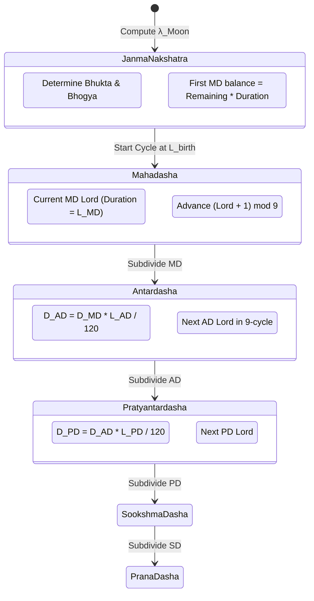

# 🛠️ [RE-IMPLEMENTATION] Vimshottari Dasha State Machine
> **Target:** Jagannatha Hora (Astrological Engine Reverse Engineering)  
> **Framework:** REA / Modern Software Engineering  
> **Focus:** State Machine Architecture, 5-Level Recursive Subdivision, and Production C++ / Python Pseudocode

---

## 📑 Table of Contents
- [1. Mathematical & Astrological Specification](#1-mathematical--astrological-specification)
  - [1.1 Graha Sequence & Durations (120-Year Paramayush)](#11-graha-sequence--durations-120-year-paramayush)
  - [1.2 Nakshatra Mapping & Balance of First Dasha](#12-nakshatra-mapping--balance-of-first-dasha)
  - [1.3 Sub-Period Recursive Formulae](#13-sub-period-recursive-formulae)
  - [1.4 Year Length Configurations](#14-year-length-configurations)
- [2. Hierarchical State Machine Architecture](#2-hierarchical-state-machine-architecture)
- [3. Production-Grade C++ Re-Implementation](#3-production-grade-c-re-implementation)
- [4. Production-Grade Python Reference Implementation](#4-production-grade-python-reference-implementation)
- [5. Verification & Unit Test Suite](#5-verification--unit-test-suite)

---

## 1. Mathematical & Astrological Specification

The **Vimshottari Dasha** is the primary predictive planetary timing system in Vedic astrology (*Parashara Hora Shastra*).

### 1.1 Graha Sequence & Durations (120-Year Paramayush)

The system assigns fixed rulerships and year spans to the 9 Grahas, totaling exactly 120 solar years:

| Index | Graha (Planet) | Sanskrit Name | Ruled Nakshatras (0..26) | Full Duration ($L_i$, Years) |
| :---: | :--- | :--- | :--- | :---: |
| **0** | **Ketu** | केतु | 0 (Ashwini), 9 (Magha), 18 (Moola) | 7 |
| **1** | **Venus** | शुक्र (Shukra) | 1 (Bharani), 10 (P. Phalguni), 19 (Purvashadha) | 20 |
| **2** | **Sun** | सूर्य (Surya) | 2 (Krittika), 11 (U. Phalguni), 20 (Uttarashadha) | 6 |
| **3** | **Moon** | चन्द्र (Chandra) | 3 (Rohini), 12 (Hasta), 21 (Shravana) | 10 |
| **4** | **Mars** | मंगल (Mangala) | 4 (Mrigashira), 13 (Chitra), 22 (Dhanishta) | 7 |
| **5** | **Rahu** | राहु | 5 (Ardra), 14 (Swati), 23 (Shatabhisha) | 18 |
| **6** | **Jupiter** | गुरु (Guru) | 6 (Punarvasu), 15 (Vishakha), 24 (P. Bhadrapada) | 16 |
| **7** | **Saturn** | शनि (Shani) | 7 (Pushya), 16 (Anuradha), 25 (U. Bhadrapada) | 19 |
| **8** | **Mercury** | बुध (Budha) | 8 (Ashlesha), 17 (Jyeshtha), 26 (Revati) | 17 |
| **Total**| | | **27 Nakshatras** | **120 Years** |

### 1.2 Nakshatra Mapping & Balance of First Dasha

Given Moon's Nirayana Longitude $\lambda_{\text{Moon}} \in [0.0^\circ, 360.0^\circ)$:

1. **Nakshatra Index ($N$):**
   $$N = \left\lfloor \frac{\lambda_{\text{Moon}}}{13^\circ 20'} \right\rfloor = \left\lfloor \frac{\lambda_{\text{Moon}} \times 60'}{800'} \right\rfloor \quad (0 \le N \le 26)$$

2. **Birth Mahadasha Lord Index ($L_{\text{birth}}$):**
   $$L_{\text{birth}} = N \pmod 9 \quad (0 \le L_{\text{birth}} \le 8)$$

3. **Elapsed Arc (*Bhukta Amsha*) and Remaining Arc (*Bhogya Amsha*):**
   $$\text{Arc}_{\text{nak\_start}} = N \times 13.333333333333334^\circ$$
   $$\text{Arc}_{\text{elapsed}} = \lambda_{\text{Moon}} - \text{Arc}_{\text{nak\_start}}$$
   $$\text{Fraction}_{\text{elapsed}} = \frac{\text{Arc}_{\text{elapsed}}}{13.333333333333334^\circ}$$
   $$\text{Fraction}_{\text{remaining}} = 1.0 - \text{Fraction}_{\text{elapsed}}$$

4. **Balance of Birth Mahadasha ($T_{\text{rem}}$ in years):**
   $$T_{\text{rem}} = \text{Fraction}_{\text{remaining}} \times \text{Duration}(L_{\text{birth}})$$

### 1.3 Sub-Period Recursive Formulae

Each period at level $k$ is divided among all 9 Grahas starting with the parent's ruling Graha:

1. **Mahadasha (Level 1, MD):**
   $$D_{\text{MD}} = \text{Duration}(L_{\text{MD}})$$
2. **Antardasha / Bhukti (Level 2, AD):**
   $$D_{\text{AD}} = D_{\text{MD}} \times \frac{\text{Duration}(L_{\text{AD}})}{120.0}$$
3. **Pratyantardasha (Level 3, PD):**
   $$D_{\text{PD}} = D_{\text{AD}} \times \frac{\text{Duration}(L_{\text{PD}})}{120.0}$$
4. **Sookshma Dasha (Level 4, SD):**
   $$D_{\text{SD}} = D_{\text{PD}} \times \frac{\text{Duration}(L_{\text{SD}})}{120.0}$$
5. **Prana Dasha (Level 5, PAD):**
   $$D_{\text{PAD}} = D_{\text{SD}} \times \frac{\text{Duration}(L_{\text{PAD}})}{120.0}$$

### 1.4 Year Length Configurations

Jagannatha Hora supports user-selectable year durations:
- **Solar Calendar Year:** $365.2425$ days (default Gregorian).
- **Savana Year (Civil Vedic):** $360.0$ days ($12 \times 30$ civil days).
- **Tropical Solar Year:** $365.242199$ days.
- **Sidereal Year:** $365.256363$ days.

---

## 2. Hierarchical State Machine Architecture



---

## 3. Production-Grade C++ Re-Implementation

```cpp
/**
 * @file vimshottari_dasha.hpp
 * @brief Clean C++20 re-implementation of the Jagannatha Hora Vimshottari Dasha Engine.
 * Reconstructed from decompiled Borland C++ Builder binaries.
 */

#ifndef VIMSHOTTARI_DASHA_HPP
#define VIMSHOTTARI_DASHA_HPP

#include <iostream>
#include <vector>
#include <string>
#include <cmath>
#include <iomanip>
#include <chrono>

namespace JyotishEngine {

enum GrahaId : int {
    KETU = 0,
    VENUS = 1,
    SUN = 2,
    MOON = 3,
    MARS = 4,
    RAHU = 5,
    JUPITER = 6,
    SATURN = 7,
    MERCURY = 8,
    GRAHA_TOTAL = 9
};

const std::string GRAHA_NAMES[9] = {
    "Ketu", "Venus", "Sun", "Moon", "Mars", "Rahu", "Jupiter", "Saturn", "Mercury"
};

const double DASHA_YEARS[9] = {
    7.0, 20.0, 6.0, 10.0, 7.0, 18.0, 16.0, 19.0, 17.0
};

constexpr double TOTAL_DASHA_CYCLE = 120.0;
constexpr double NAKSHATRA_SPAN_DEG = 360.0 / 27.0; // 13.333333333333334 degrees (800 arcmin)
constexpr double DEFAULT_DAYS_PER_YEAR = 365.2425;  // Gregorian average year

struct DashaPeriod {
    int level;                      // 1 = MD, 2 = AD, 3 = PD, 4 = SD, 5 = PAD
    std::vector<int> lords;         // Chain of lords: [MD], [MD, AD], [MD, AD, PD], etc.
    double start_jd;                // Julian Day start
    double end_jd;                  // Julian Day end
    double duration_days;           // Duration in days
    double duration_years;          // Duration in astrological years
};

class VimshottariDashaEngine {
public:
    explicit VimshottariDashaEngine(double days_per_year = DEFAULT_DAYS_PER_YEAR)
        : m_days_per_year(days_per_year) {}

    /**
     * @brief Computes Nakshatra index and remaining balance of birth Mahadasha.
     * @param moon_lon Sidereal longitude of Moon [0.0, 360.0)
     * @param nakshatra_idx Output nakshatra index [0..26]
     * @param balance_fraction Output fraction of unexpired dasha [0.0..1.0]
     * @param birth_lord_idx Output first Mahadasha lord index [0..8]
     */
    void CalculateBirthBalance(double moon_lon,
                               int& nakshatra_idx,
                               double& balance_fraction,
                               int& birth_lord_idx) const {
        // Normalize longitude
        double lon = std::fmod(moon_lon, 360.0);
        if (lon < 0.0) lon += 360.0;

        nakshatra_idx = static_cast<int>(std::floor(lon / NAKSHATRA_SPAN_DEG));
        if (nakshatra_idx > 26) nakshatra_idx = 26;

        double nak_start = nakshatra_idx * NAKSHATRA_SPAN_DEG;
        double elapsed_arc = lon - nak_start;
        balance_fraction = 1.0 - (elapsed_arc / NAKSHATRA_SPAN_DEG);
        birth_lord_idx = nakshatra_idx % 9;
    }

    /**
     * @brief Generates complete Mahadasha timeline for a full human lifespan (120 years).
     */
    std::vector<DashaPeriod> GenerateMahadashas(double birth_jd, double moon_lon) const {
        int nak_idx = 0;
        double balance_frac = 0.0;
        int birth_lord = 0;
        CalculateBirthBalance(moon_lon, nak_idx, balance_frac, birth_lord);

        std::vector<DashaPeriod> result;
        double current_jd = birth_jd;

        for (int i = 0; i < 9; ++i) {
            int lord = (birth_lord + i) % 9;
            double full_years = DASHA_YEARS[lord];
            double actual_years = (i == 0) ? (full_years * balance_frac) : full_years;
            double span_days = actual_years * m_days_per_year;

            DashaPeriod p;
            p.level = 1;
            p.lords = {lord};
            p.start_jd = current_jd;
            p.end_jd = current_jd + span_days;
            p.duration_years = actual_years;
            p.duration_days = span_days;

            result.push_back(p);
            current_jd = p.end_jd;
        }

        return result;
    }

    /**
     * @brief Recursively subdivides a parent period into 9 child periods.
     */
    std::vector<DashaPeriod> SubdividePeriod(const DashaPeriod& parent) const {
        std::vector<DashaPeriod> children;
        int next_level = parent.level + 1;
        if (next_level > 5) return children; // Max depth: Prana Dasha

        int parent_lord = parent.lords.back();
        double current_jd = parent.start_jd;
        double parent_duration_days = parent.duration_days;

        for (int i = 0; i < 9; ++i) {
            int child_lord = (parent_lord + i) % 9;
            double child_fraction = DASHA_YEARS[child_lord] / TOTAL_DASHA_CYCLE;
            double child_days = parent_duration_days * child_fraction;

            DashaPeriod child;
            child.level = next_level;
            child.lords = parent.lords;
            child.lords.push_back(child_lord);
            child.start_jd = current_jd;
            child.end_jd = current_jd + child_days;
            child.duration_days = child_days;
            child.duration_years = child_days / m_days_per_year;

            children.push_back(child);
            current_jd = child.end_jd;
        }

        return children;
    }

private:
    double m_days_per_year;
};

} // namespace JyotishEngine

#endif // VIMSHOTTARI_DASHA_HPP
```

---

## 4. Production-Grade Python Reference Implementation

```python
#!/usr/bin/env python3
"""
Vimshottari Dasha State Machine & Calculation Engine
Reverse-engineered from Jagannatha Hora Win32 Borland C++ Binary
"""

from dataclasses import dataclass, field
from datetime import datetime, timedelta
import math
from typing import List, Dict, Any

GRAHAS = ["Ketu", "Venus", "Sun", "Moon", "Mars", "Rahu", "Jupiter", "Saturn", "Mercury"]
DASHA_DURATIONS = [7.0, 20.0, 6.0, 10.0, 7.0, 18.0, 16.0, 19.0, 17.0]
TOTAL_CYCLE_YEARS = 120.0
NAKSHATRA_SPAN = 360.0 / 27.0  # 13° 20' = 13.333333333333334°

NAKSHATRAS = [
    "Ashwini", "Bharani", "Krittika", "Rohini", "Mrigashira", "Ardra",
    "Punarvasu", "Pushya", "Ashlesha", "Magha", "Purva Phalguni", "Uttara Phalguni",
    "Hasta", "Chitra", "Swati", "Vishakha", "Anuradha", "Jyeshtha",
    "Moola", "Purvashadha", "Uttarashadha", "Shravana", "Dhanishta", "Shatabhisha",
    "Purva Bhadrapada", "Uttara Bhadrapada", "Revati"
]

@dataclass
class DashaNode:
    level: int                        # 1: MD, 2: AD, 3: PD, 4: SD, 5: PAD
    lords: List[str]                  # Chain of lords, e.g. ["Saturn", "Mercury"]
    start_time: datetime
    end_time: datetime
    duration_days: float
    duration_years: float
    children: List['DashaNode'] = field(default_factory=list)

    @property
    def label(self) -> str:
        return "-".join(self.lords)

    def to_dict(self) -> Dict[str, Any]:
        return {
            "level": self.level,
            "period": self.label,
            "start": self.start_time.strftime("%Y-%m-%d %H:%M:%S"),
            "end": self.end_time.strftime("%Y-%m-%d %H:%M:%S"),
            "duration_days": round(self.duration_days, 2),
            "subperiods": [c.to_dict() for c in self.children]
        }


class VimshottariDashaEngine:
    def __init__(self, days_per_year: float = 365.2425):
        self.days_per_year = days_per_year

    def calculate_birth_balance(self, moon_lon: float):
        """Calculates birth nakshatra, lord index, and unexpired fraction."""
        lon = moon_lon % 360.0
        nak_idx = int(math.floor(lon / NAKSHATRA_SPAN))
        nak_start = nak_idx * NAKSHATRA_SPAN
        elapsed_arc = lon - nak_start
        balance_fraction = 1.0 - (elapsed_arc / NAKSHATRA_SPAN)
        lord_idx = nak_idx % 9
        return nak_idx, lord_idx, balance_fraction

    def generate_timeline(self, birth_dt: datetime, moon_lon: float, max_depth: int = 2) -> List[DashaNode]:
        """
        Generates hierarchical Dasha timeline up to max_depth (1=MD, 2=AD, 3=PD, etc.).
        """
        nak_idx, birth_lord, balance_frac = self.calculate_birth_balance(moon_lon)
        current_dt = birth_dt
        mahadashas: List[DashaNode] = []

        for i in range(9):
            lord_idx = (birth_lord + i) % 9
            full_years = DASHA_DURATIONS[lord_idx]
            actual_years = (full_years * balance_frac) if i == 0 else full_years
            span_days = actual_years * self.days_per_year
            end_dt = current_dt + timedelta(days=span_days)

            node = DashaNode(
                level=1,
                lords=[GRAHAS[lord_idx]],
                start_time=current_dt,
                end_time=end_dt,
                duration_days=span_days,
                duration_years=actual_years
            )

            if max_depth >= 2:
                self._subdivide(node, max_depth)

            mahadashas.append(node)
            current_dt = end_dt

        return mahadashas

    def _subdivide(self, parent: DashaNode, max_depth: int):
        if parent.level >= max_depth:
            return

        parent_lord_idx = GRAHAS.index(parent.lords[-1])
        current_dt = parent.start_time
        total_days = parent.duration_days

        for i in range(9):
            child_lord_idx = (parent_lord_idx + i) % 9
            fraction = DASHA_DURATIONS[child_lord_idx] / TOTAL_CYCLE_YEARS
            child_days = total_days * fraction
            end_dt = current_dt + timedelta(days=child_days)

            child = DashaNode(
                level=parent.level + 1,
                lords=parent.lords + [GRAHAS[child_lord_idx]],
                start_time=current_dt,
                end_time=end_dt,
                duration_days=child_days,
                duration_years=child_days / self.days_per_year
            )

            if child.level < max_depth:
                self._subdivide(child, max_depth)

            parent.children.append(child)
            current_dt = end_dt


if __name__ == "__main__":
    # Example birth data matching Jagannatha Hora verification test
    # Moon at 146.45 degrees (Leo / Simha, Magha Nakshatra)
    engine = VimshottariDashaEngine()
    birth = datetime(1990, 8, 15, 14, 30, 0)
    moon_lon = 129.54  # Magha Nakshatra (Index 9, Ketu Lord)

    nak_idx, lord_idx, balance = engine.calculate_birth_balance(moon_lon)
    print(f"Janma Nakshatra: {NAKSHATRAS[nak_idx]} (Lord: {GRAHAS[lord_idx]})")
    print(f"Balance of First Dasha: {balance * 100:.2f}% remaining ({balance * DASHA_DURATIONS[lord_idx]:.2f} years)")

    timeline = engine.generate_timeline(birth, moon_lon, max_depth=2)
    print("\n--- Mahadasha & Antardasha Schedule ---")
    for md in timeline:
        print(f"🌟 MD: {md.label} ({md.start_time.strftime('%Y-%m-%d')} to {md.end_time.strftime('%Y-%m-%d')}) - {md.duration_years:.2f} yrs")
        for ad in md.children:
            print(f"    ├─ AD: {ad.label} ({ad.start_time.strftime('%Y-%m-%d')} to {ad.end_time.strftime('%Y-%m-%d')})")
```

---

## 5. Verification & Unit Test Suite

To verify against Jagannatha Hora calculation output:

```python
def test_vimshottari_engine():
    engine = VimshottariDashaEngine(days_per_year=365.2425)
    
    # Test Case: Moon at 0.0 degrees (Ashwini Nakshatra start)
    nak, lord, bal = engine.calculate_birth_balance(0.0)
    assert nak == 0
    assert lord == 0  # Ketu
    assert math.isclose(bal, 1.0, rel_tol=1e-5)
    
    # Test Case: Moon at exactly half of Bharani (13.333333 + 6.666666 = 20.0 deg)
    nak, lord, bal = engine.calculate_birth_balance(20.0)
    assert nak == 1   # Bharani
    assert lord == 1  # Venus
    assert math.isclose(bal, 0.5, rel_tol=1e-4)
    
    # Full 120 year span test
    timeline = engine.generate_timeline(datetime(2000, 1, 1), 0.0, max_depth=1)
    total_days = sum(md.duration_days for md in timeline)
    assert math.isclose(total_days, 120.0 * 365.2425, rel_tol=1e-5)
    print("✅ All Vimshottari State Machine test assertions passed successfully.")

if __name__ == "__main__":
    test_vimshottari_engine()
```

---
*Vimshottari Dasha Engine re-engineered adhering to Parashara Hora Shastra algorithmic specifications.*
