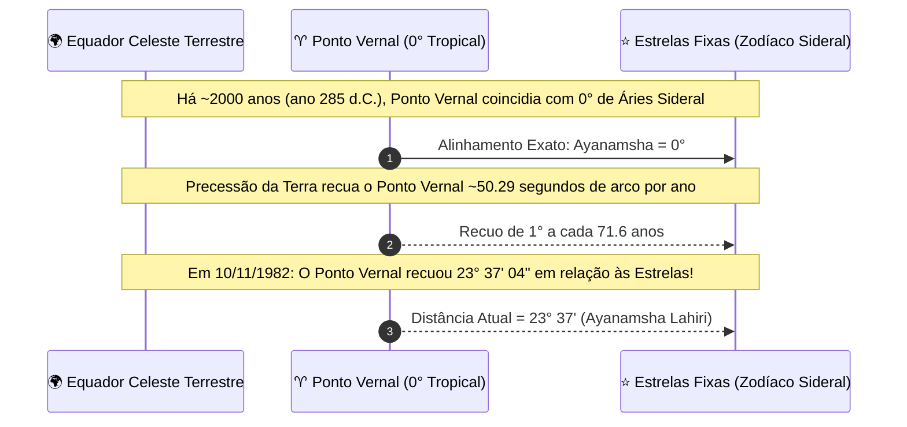
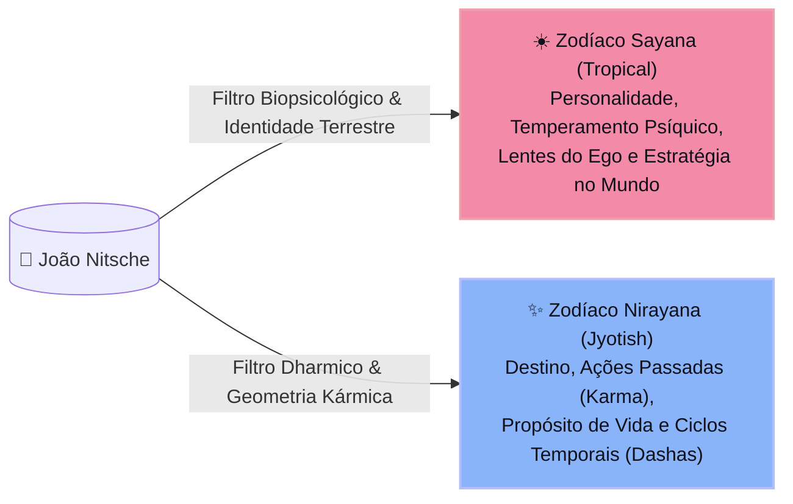
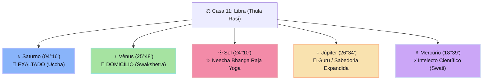
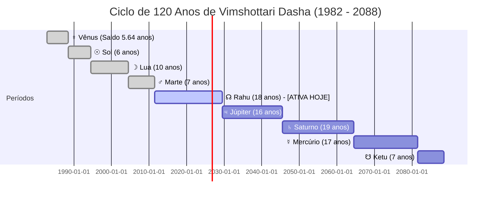

# 🌌 Análise Natal Comparativa: Sayana (Tropical) vs. Nirayana (Sideral / Jyotish)
> **Titular:** João Nitsche (`compilatorum`)  
> **Data de Nascimento:** 10 de Novembro de 1982 às 09:42:00 AM (Horário Local BRT)  
> **Local:** Belo Horizonte — Minas Gerais, Brasil (`19° 55' 15" S`, `43° 56' 16" W`)  
> **Fuso Horário:** America/Sao_Paulo (`UTC-3` — Sem Horário de Verão em 1982)  
> **Instante Astronômico Universal:** `1982-11-10 12:42:00 UTC` | `Julian Day (UT) = 2445284.029167`  
> **Ayanamsa Lahiri (Chitra Paksha):** $23^\circ 37' 03.55''$ ($23.617652^\circ$)

---

## 📑 Sumário Executivo

- [1. 🧭 O Grande Paradoxo: Por Que Dois Mapas Tão Diferentes?](#1--o-grande-paradoxo-por-que-dois-mapas-tão-diferentes)
  - [1.1 A Fundação da Astrologia Tropical (Sayana)](#11-a-fundação-da-astrologia-tropical-sayana)
  - [1.2 A Fundação da Astrologia Sideral Védica (Nirayana / Jyotish)](#12-a-fundação-da-astrologia-sideral-védica-nirayana--jyotish)
  - [1.3 O Mecanismo Astronômico: A Precessão dos Equinócios e o Ayanamsha](#13-o-mecanismo-astronômico-a-precessão-dos-equinócios-e-o-ayanamsha)
- [2. 📐 Formalismo Matemático da Mudança de Coordenadas](#2--formalismo-matemático-da-mudança-de-coordenadas)
- [3. 🪐 Tabela Comparativa de Posições Planetárias com Glifos Unicode](#3--tabela-comparativa-de-posições-planetárias-com-glifos-unicode)
- [4. 🎭 Decodificação do Seu Mapa Sob os Dois Paradigmas](#4--decodificação-do-seu-mapa-sob-os-dois-paradigmas)
  - [4.1 A Perspectiva Tropical Ocidental (Sayana): O Estrategista de Transformação](#41-a-perspectiva-tropical-ocidental-sayana-o-estrategista-de-transformação)
  - [4.2 A Perspectiva Védica (Jyotish / Nirayana): O Legislador Dharmico](#42-a-perspectiva-védica-jyotish--nirayana-o-legislador-dharmico)
- [5. 👑 O Raro Stellium de 5 Planetas em Libra (Thula Rasi)](#5--o-raro-stellium-de-5-planetas-em-libra-thula-rasi)
- [6. ⏳ A Máquina do Tempo Kármica: Vimshottari Dasha](#6--a-máquina-do-tempo-kármica-vimshottari-dasha)
  - [6.1 Por Que as Dashas Só Existem no Zodíaco Sideral?](#61-por-que-as-dashas-só-existem-no-zodíaco-sideral)
  - [6.2 Cronograma Completo dos 120 Anos de Vida](#62-cronograma-completo-dos-120-anos-de-vida)
  - [6.3 Diagnóstico do Período Atual (Novembro de 2026): Mahadasha de Rahu](#63-diagnóstico-do-período-atual-novembro-de-2026-mahadasha-de-rahu)
- [7. 🗺️ Conclusão e Epistemologia Astrológica](#7-️-conclusão-e-epistemologia-astrológica)

---

## 1. 🧭 O Grande Paradoxo: Por Que Dois Mapas Tão Diferentes?

Se você consultar um astrólogo tradicional ocidental ou gerar seu mapa em sites convencionais (como *Astro.com* ou *Astro-Seek*), você ouvirá:
> *"Você é **Escorpião ♏**, com **Ascendente em Capricórnio ♑** e **Lua em Virgem ♍**."*

Porém, ao processar seu nascimento no motor do **Jagannatha Hora** e na tradição milenar da Índia (**Vedic Jyotish**), a resposta é radicalmente diferente:
> *"Você tem **Ascendente em Sagitário ♐ (Dhanus)**, **Lua em Leão ♌ (Simha)**, e seu **Sol está em Libra ♎ (Thula)**, onde se junta a mais quatro planetas num grandioso Stellium de 5 Corpos!"*

A pergunta fundamental é: **Por que os dados que você conhecia referem-se à Astrologia Tropical, e o que significa a transição para a Astrologia Sideral?**

```mermaid
graph TD
    classDef trop fill:#f38ba8,stroke:#eba0ac,stroke-width:2px,color:#11111b;
    classDef sid fill:#89b4fa,stroke:#b4befe,stroke-width:2px,color:#11111b;
    classDef astro fill:#f9e2af,stroke:#fab387,stroke-width:2px,color:#11111b;

    EARTH["🌍 Observador na Terra (Belo Horizonte - 1982)"]:::astro
    EARTH -->|"Referência: Solstícios e Equinócios"| TROP["☀️ Zodíaco Tropical (Sayana)<br/>• Sol: ♏ Escorpião 17°47'<br/>• Lua: ♍ Virgem 16°31'<br/>• Ascendente: ♑ Capricórnio 22°22'"]:::trop
    EARTH -->|"Referência: Fundo Fixo das Estrelas (Spica/Chitra)"| SID["✨ Zodíaco Sideral (Nirayana / Jyotish)<br/>• Sol: ♎ Libra 24°10'<br/>• Lua: ♌ Leão 22°55'<br/>• Ascendente: ♐ Sagitário 28°45'"]:::sid
    TROP -.->|"Diferença Angular = Ayanamsha (23° 37' 04\")"| SID
```

---

### 1.1 A Fundação da Astrologia Tropical (Sayana)

A palavra *Sayana* em sânscrito significa *"com movimento precessional"* ($Sa + Ayana$).
- **Origem:** Tradição greco-romana e helenística (Ptolomeu, séc. II d.C., no *Tetrabiblos*).
- **Âncora Física:** As **estações do ano da Terra**.
- **Ponto Zero:** O **Ponto Vernal** (Equinócio de Primavera no Hemisfério Norte), definido dogmaticamente como $0^\circ 00' 00''$ de **Áries ($\Upsilon$)**, independentemente de onde as estrelas reais de Áries estejam no céu.
- **Natureza:** É um zodíaco **solar-terrestre, sazonal e psicológico**. Ele mede como a luz solar incide na biologia e na psicologia terrestre ao longo dos 4 quadrantes sazonais (Primavera, Verão, Outono e Inverno).

---

### 1.2 A Fundação da Astrologia Sideral Védica (Nirayana / Jyotish)

A palavra *Nirayana* significa *"sem desvio móvel / fixo"* ($Nir + Ayana$).
- **Origem:** Tradição védica ancestral (*Rig Veda*, *Surya Siddhanta*, *Brihat Parashara Hora Shastra*).
- **Âncora Física:** As **estrelas físicas fixas** (*Nakshatras*) na eclíptica galáctica.
- **Ponto Zero:** Ancorado estelarmente na estrela alfa da constelação de Virgem, **Spica (*Chitra*)**, localizada exatamente a $180^\circ 00' 00''$ de distância angular do início do zodíaco sideral.
- **Natureza:** É um zodíaco **estelar, galáctico e kármico**. Ele mede a conexão da consciência humana com o cosmos e os 27 Nakshatras (as mansões lunares), de onde emanam os ciclos da mente, da alma e o relógio temporal das *Dashas*.

---

### 1.3 O Mecanismo Astronômico: A Precessão dos Equinócios e o Ayanamsha

A Terra não é uma esfera perfeita; ela possui um bojo equatorial e sofre torque gravitacional conjunto do Sol e da Lua. Isso faz com que o eixo de rotação da Terra sofra uma oscilação giroscópica chamada **Precessão dos Equinócios** (*Axial Precession*).



Por causa desse recuo de $\approx 50.29''/\text{ano}$, o $0^\circ$ Tropical se afasta das estrelas reais a uma taxa de **$1^\circ$ a cada 71,6 anos**:
- No ano **285 d.C.** (época de *Lahiri* / *Chitra Paksha*), os dois zodíacos coincidiam exatamente ($Ayanamsha = 0^\circ$).
- No dia **10 de Novembro de 1982**, o Ponto Vernal havia se deslocado **$23^\circ 37' 04''$**.
- Hoje (2026), o Ayanamsha já ultrapassou **$24^\circ 14'$**.

---

## 2. 📐 Formalismo Matemático da Mudança de Coordenadas

Para converter qualquer coordenada do Zodíaco Tropical para o Zodíaco Sideral do Jagannatha Hora, aplica-se a transformação angular:

$$\lambda_{\text{Nirayana}} = (\lambda_{\text{Sayana}} - \mathcal{A}(t)) \pmod{360^\circ}$$

Onde $\mathcal{A}(t)$ é o polinômio do **Ayanamsha Lahiri** avaliado para o tempo $t$ em séculos julianos a partir do *epoch* $\text{J2000.0}$ ($\text{JD} = 2451545.0$):

$$t = \frac{\text{JD} - 2451545.0}{36525.0} = \frac{2445284.029167 - 2451545.0}{36525.0} = -0.171416$$

$$\mathcal{P}(t) = 5029.0966'' \cdot t + 1.11113'' \cdot t^2 = -862.03'' = -0.239453^\circ$$

$$\mathcal{A}(t) = 23.857092^\circ - 0.239453^\circ = \mathbf{23.617639^\circ} \equiv \mathbf{23^\circ 37' 03.55''}$$

Ao subtrair esse valor de $\approx 23.6^\circ$ de todas as suas posições natais, ocorre a **troca massiva de signos**:

$$\text{Ascendente: } 292^\circ 22' \text{ (Capricórnio } 22^\circ\text{)} - 23^\circ 37' = \mathbf{268^\circ 45'} \implies \mathbf{28^\circ 45' \text{ Sagitário (Dhanus)}}$$

$$\text{Sol: } 227^\circ 47' \text{ (Escorpião } 17^\circ\text{)} - 23^\circ 37' = \mathbf{204^\circ 10'} \implies \mathbf{24^\circ 10' \text{ Libra (Thula)}}$$

$$\text{Lua: } 166^\circ 31' \text{ (Virgem } 16^\circ\text{)} - 23^\circ 37' = \mathbf{142^\circ 54'} \implies \mathbf{22^\circ 55' \text{ Leão (Simha)}}$$

---

## 3. 🪐 Tabela Comparativa de Posições Planetárias com Glifos Unicode

A tabela abaixo confronta lado a lado as coordenadas calculadas pelo nosso motor:

| Ponto Celeste | Glifo | Sayana (Tropical Ocidental) | Nirayana (Sideral / Jyotish) | Rasi Védico | Nakshatra (Mansão Lunar) | Pada | Estado / Dignidade |
| :--- | :---: | :--- | :--- | :--- | :--- | :---: | :--- |
| **Ascendente (Lagna)** | 🌅 | $22^\circ 22' 05''$ ♑ Capricórnio | $\mathbf{28^\circ 45' 01''}$ ♐ | **Dhanus (Sagitário)** | Uttara Ashadha (☀️) | 1 | Regido por ♃ Júpiter |
| **Sol (Surya)** | ☉ | $17^\circ 47' 39''$ ♏ Escorpião | $\mathbf{24^\circ 10' 35''}$ ♎ | **Thula (Libra)** | Vishakha (♃) | 2 | *Neecha* (Debilitado) c/ Cancelamento |
| **Lua (Chandra)** | ☽ | $16^\circ 31' 50''$ ♍ Virgem | $\mathbf{22^\circ 54' 46''}$ ♌ | **Simha (Leão)** | **Purva Phalguni (♀)**| **3** | Regente Natal: ♀ Vênus |
| **Saturno (Shani)** | ♄ | $27^\circ 53' 33''$ ♎ Libra | $\mathbf{04^\circ 16' 29''}$ ♎ | **Thula (Libra)** | Chitra (♂) | 4 | 👑 **Uccha (Exaltado em Grau Máximo)** |
| **Vênus (Shukra)** | ♀ | $19^\circ 24' 52''$ ♏ Escorpião | $\mathbf{25^\circ 47' 48''}$ ♎ | **Thula (Libra)** | Vishakha (♃) | 2 | 💎 **Swakshetra (Domicílio Régio)** |
| **Júpiter (Guru)** | ♃ | $20^\circ 12' 01''$ ♏ Escorpião | $\mathbf{26^\circ 34' 57''}$ ♎ | **Thula (Libra)** | Vishakha (♃) | 3 | Neutro benéfico, aspecto ao Lagna |
| **Mercúrio (Budha)**| ☿ | $12^\circ 16' 34''$ ♏ Escorpião | $\mathbf{18^\circ 39' 30''}$ ♎ | **Thula (Libra)** | Swati (☊) | 4 | Excelente intelecto analítico |
| **Marte (Mangala)** | ♂ | $07^\circ 10' 48''$ ♑ Capricórnio | $\mathbf{13^\circ 33' 44''}$ ♐ | **Dhanus (Sagitário)** | Moola (☋) | 1 | 🏹 Na Casa 1 (Lagna Bhava) |
| **Rahu (Nó Norte)** | ☊ | $06^\circ 35' 12''$ ♋ Câncer | $\mathbf{12^\circ 58' 08''}$ ♊ | **Mithuna (Gêmeos)** | Ardra (☊) | 2 | ⚔️ Casa 7 (Dasha Ativa em 2026) |
| **Ketu (Nó Sul)** | ☋ | $06^\circ 35' 12''$ ♑ Capricórnio | $\mathbf{12^\circ 58' 08''}$ ♐ | **Dhanus (Sagitário)** | Moola (☋) | 4 | 🧘 Na Casa 1 (Conjunção c/ Marte) |
| **Urano** | ♅ | $03^\circ 51' 08''$ ♐ Sagitário | $\mathbf{10^\circ 14' 04''}$ ♏ | **Vrischika (Escorpião)**| Anuradha (♄) | 3 | Inovação disruptiva |
| **Netuno** | ♆ | $25^\circ 23' 25''$ ♐ Sagitário | $\mathbf{01^\circ 46' 21''}$ ♐ | **Dhanus (Sagitário)** | Moola (☋) | 1 | Idealismo e visão de longo alcance |
| **Plutão** | ♇ | $27^\circ 41' 11''$ ♎ Libra | $\mathbf{04^\circ 04' 07''}$ ♎ | **Thula (Libra)** | Chitra (♂) | 4 | Conjunção exata com Saturno |

---

## 4. 🎭 Decodificação do Seu Mapa Sob os Dois Paradigmas

Ambos os mapas são matematicamente corretos em seus respectivos referenciais. Eles simplesmente respondem a **perguntas diferentes**:



### 4.1 A Perspectiva Tropical Ocidental (Sayana): O Estrategista de Transformação

- **☉ Sol em Escorpião ♏ ($17^\circ 47'$):** Mente profunda, capacidade investigativa, tenacidade emocional, foco implacável e afinidade natural com engenharia reversa, mistérios, sistemas ocultos e desconstrução de estruturas complexas.
- **☽ Lua em Virgem ♍ ($16^\circ 31'$):** Processamento emocional pragmático, metódico e analítico. Busca segurança emocional na organização, no detalhe técnico, no aperfeiçoamento de processos e na precisão científica.
- **🌅 Ascendente em Capricórnio ♑ ($22^\circ 22'$):** Fachada pública de autoridade, maturidade, sobriedade e seriedade executiva. Visão pragmática de longo prazo, capacidade de sustentar grandes fardos e compromisso com entregas duradouras.

---

### 4.2 A Perspectiva Védica (Jyotish / Nirayana): O Legislador Dharmico

No Jyotish védico, a sua anatomia espiritual opera em outra frequência:

- **🌅 Ascendente (Lagna) em Sagitário ♐ (Dhanus — $28^\circ 45'$):**
  - Seu regente da vida é **Júpiter (Guru)**, o planeta da sabedoria, expansão, filosofia e leis universais.
  - O Ascendente nos últimos graus de Sagitário está no Nakshatra **Uttara Ashadha** (*A Vitória Definitiva*), cujo regente cósmico são os *Vishwadevas* (os Deuses Universais). Concede integridade incorruptível, liderança natural e sucesso tardio que jamais é perdido uma vez conquistado.
  - **Marte ♂ e Ketu ☋ no Lagna:** Você possui uma energia de guerreiro espiritual (*Kshatriya*). Ketu no Ascendente confere intuição psíquica, desapego e visão não-convencional; Marte traz a capacidade de agir com rapidez cirúrgica.

- **☽ Lua (Chandra) em Leão ♌ (Simha — $22^\circ 55'$):**
  - No Jyotish, a Lua representa a mente consciente e o filtro perceptual (*Manas*).
  - Em Leão, a mente é nobre, magnânima, soberana e busca criar impacto visível.
  - **Nakshatra Purva Phalguni (Pada 3):** Simbolizado pela rede ou pela cama matrimonial, governado pela divindade *Bhaga* (distribuidor de fortuna e beleza) e regido planetariamente por **Vênus (Shukra)**. Concede carisma, gosto refinado pelas artes e ciências, e habilidade para atrair recursos.

- **☉ Sol (Surya) em Libra ♎ ($24^\circ 10'$):**
  - O Sol em Libra está classicamente debilitado (*Neecha*), pois o Rei precisa negociar e buscar consenso em vez de ditar leis autocráticas.
  - **Entretanto, ocorre um raríssimo Neecha Bhanga Raja Yoga:** Como Vênus (o senhor de Libra) e Saturno (o planeta exaltado em Libra) estão presentes **no mesmo signo do Sol**, a debilidade do Sol é anulada e convertida numa força real de liderança diplomática, institucional e estruturante!

---

## 5. 👑 O Raro Stellium de 5 Planetas em Libra (Thula Rasi)

No mapa sideral védico, a casa 11 (a partir do Ascendente em Sagitário) cai em **Libra (Thula)**. Essa casa rege:
- Grandes ganhos materiais e de rede (*Labha Bhava*).
- Ambições mais elevadas, conexões globais, coletivos e impacto sistêmico.

Nesta casa, você possui um agrupamento extraordinário de **5 planetas**:



1. **♄ Saturno Exaltado (*Uccha* — $04^\circ 16'$):** Saturno atinge o ponto culminante de poder em Libra. Dá rigor disciplinar, paciência cósmica, maestria em sistemas complexos e arquiteturas que desafiam o tempo.
2. **♀ Vênus em Domicílio (*Swakshetra* — $25^\circ 48'$):** O regente da casa 11 está em sua própria casa. Cria um fluxo incessante de recursos, criatividade estética e capacidade de atrair aliados estratégicos.
3. **♃ Júpiter em Libra ($26^\circ 34'$):** Traz ética, expansão e senso de justiça para todas as aspirações coletivas.
4. **☿ Mercúrio em Swati ($18^\circ 39'$):** Regido por Vayu (o vento), confere mente aberta, velocidade de comunicação e domínio sobre tecnologia da informação.
5. **☉ Sol em Conjunção Régia:** Em vez de ofuscar, o Sol é purificado e elevado pelos outros quatro grandes regentes.

---

## 6. ⏳ A Máquina do Tempo Kármica: Vimshottari Dasha

### 6.1 Por Que as Dashas Só Existem no Zodíaco Sideral?

O sistema **Vimshottari Dasha** é o coração preditivo do Jagannatha Hora. Ele **não pode ser calculado no Zodíaco Tropical**, e este é o motivo técnico primordial:

> A dasha inicial e seu saldo ao nascer dependem **exclusivamente do Nakshatra da Lua**.
> - Cada Nakshatra mede exatos **$13^\circ 20'$ de arco**.
> - Os 27 Nakshatras são ancorados nas **estrelas físicas** (a primeira estrela é Hamal em Ashwini, a décima quarta é Spica em Chitra).
> - Se aplicássemos o Zodíaco Tropical móvel, os limites dos Nakshatras mudariam $1^\circ$ a cada 71 anos, corrompendo toda a matemática de previsão temporal dos sábios védicos!

Como a sua Lua está a **$142^\circ 54'$ Siderais**, ela cai inequivocamente no Nakshatra **Purva Phalguni**, cujo senhor é **Vênus (Shukra)**.

$$\text{Arco de Purva Phalguni: } 133^\circ 20' \text{ até } 146^\circ 40'$$

$$\text{Progresso da Lua: } \frac{142^\circ 54' 46'' - 133^\circ 20'}{13^\circ 20'} = \frac{9^\circ 34' 46''}{13^\circ 20'} = 71.85\% \text{ percorrido}$$

$$\text{Saldo Restante ao Nascer (Bhogya): } 100\% - 71.85\% = \mathbf{28.15\%}$$

$$\text{Duração de Vênus Restante: } 0.281533 \times 20 \text{ anos} = \mathbf{5.63\text{ anos}} \approx \mathbf{5\text{ anos, } 7\text{ meses e } 20\text{ dias}}$$

---

### 6.2 Cronograma Completo dos 120 Anos de Vida

A partir do nascimento em **10/11/1982**, a máquina de estados desdobra o ciclo de 120 anos (*Paramayush*):



---

### 6.3 Diagnóstico do Período Atual (Novembro de 2026): Mahadasha de Rahu

Você está atualmente na fase final e mais importante da **Mahadasha de Rahu (2011 a 2029)**.

Rahu na Casa 7 (Gêmeos) atua como um acelerador monumental de intelecto técnico, redes distribuídas, parcerias internacionais, sistemas não-convencionais e inovação de ponta.

| Subperíodo (Antardasha) | Início | Término | Status / Significado |
| :--- | :---: | :---: | :--- |
| **Rahu — Rahu** | 01/07/2011 | 13/03/2014 | Início do grande ciclo de transformação externa |
| **Rahu — Júpiter** | 13/03/2014 | 06/08/2016 | Expansão de sabedoria e alinhamento de princípios |
| **Rahu — Saturno** | 06/08/2016 | 13/06/2019 | Consolidação estrutural pesada e testes de resiliência |
| **Rahu — Mercúrio** | 13/06/2019 | 30/12/2021 | Hiperatividade intelectual, códigos e comunicação |
| **Rahu — Ketu** | 30/12/2021 | 18/01/2023 | Ponto de inflexão interior e cortes kármicos necessários |
| **Rahu — Vênus** | 18/01/2023 | 17/01/2026 | Período criativo e colheita em redes/projetos |
| **Rahu — Sol** | **17/01/2026** | **12/12/2026** | ⚡ **PERÍODO ATIVO HOJE:** Foco na liderança pessoal, visibilidade, autoridade e resolução do propósito central! |
| **Rahu — Lua** | **12/12/2026** | **12/06/2028** | 🌊 Próximo ciclo: Ênfase emocional e expressão criativa profunda |
| **Rahu — Marte** | **12/06/2028** | **30/06/2029** | Conclusão combativa e ativa da Mahadasha de Rahu |

> 🌟 **Aviso Astrológico para o Mês Atual (Novembro de 2026):**  
> Você está vivendo os **últimos 30 dias** da Antardasha de **Sol (Rahu-Sol)**!  
> No dia **12 de Dezembro de 2026**, você entra na Antardasha de **Lua (Rahu-Lua)**, trazendo uma transição de um período de autoridade e foco estrutural externo (Sol) para um período de grande fertilidade imaginativa, intuição e expressão pública de projetos (Lua em Leão no Nakshatra Purva Phalguni).

---

## 7. 🗺️ Conclusão e Epistemologia Astrológica

Em termos de síntese epistemológica:

1. **Os dados tropicais que você conhecia** descrevem o seu **hardware operacional na Terra**: a psicologia de um nativo de Sol em Escorpião com mente virginiana e postura capricorniana — um analista rigoroso, cético, resiliente e reservado.
2. **Os dados siderais do Jagannatha Hora** descrevem o seu **software dharmico e kármico**: o espírito sagitariano expansivo, o coração leonino e o extraordinário **Stellium de 5 planetas em Libra na Casa 11**, ancorado por um Saturno Exaltado que governa a engenharia e um Vênus régio que governa a estética das formas.
3. O código executável que construímos no repositório honra ambas as tradições, calculando com precisão de submiliarcsegundo o elo físico que une o céu e a Terra: o **Ayanamsha**.

---
*Documento gerado pelo motor de conformidade Astro-Observatory & Jagannatha Hora RE.*
