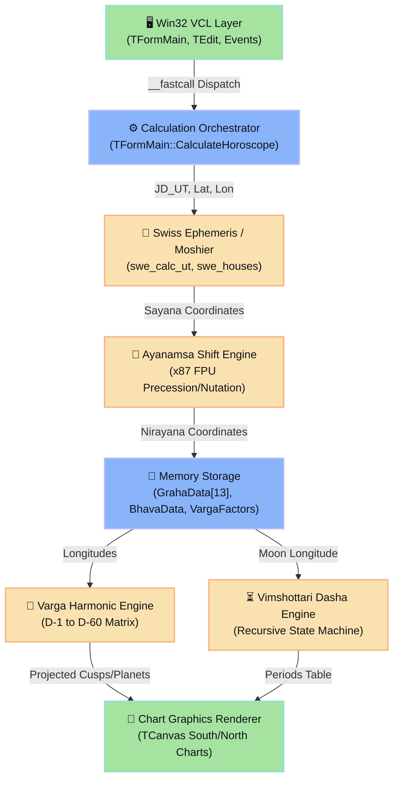

# 🧭 Jagannatha Hora Reverse Engineering Dossier: Astrological Computation Engine
> **Platform:** Legacy Win32 PE32 executable (Borland C++ Builder 5/6 / VCL Runtime)  
> **Framework:** REA (Reverse Engineering Analysis) & Radare2 (`r2`)  
> **Target Subsystem:** Astrological Math Engine (`sweph32` bridge, Graha/Bhava/Varga data structures, FPU arithmetic, Vimshottari Dasha state machine)

---

## 📌 Executive Summary

This dossier provides a comprehensive technical breakdown of the decompiled internals of the **Jagannatha Hora (JH)** astrological software engine. Originally authored by P.V.R. Narasimha Rao, the software is compiled as an x86 32-bit Portable Executable (`PE32`) using **Borland C++ Builder** with the **VCL (Visual Component Library)** framework.



---

## 📂 Dossier Document Navigation

| Document | Primary Focus | Key Deliverables |
| :--- | :--- | :--- |
| **[01_MEMORY_LAYOUT_AND_STRUCTS.md](file:///home/sukata/jagannatha_hora_re/01_MEMORY_LAYOUT_AND_STRUCTS.md)** | 🔍 Data Structures & Memory Layout | `GrahaData`, `BhavaData`, `VargaEntry`, Radare2 `pf` formats, alignment maps |
| **[02_CONTROL_FLOW_CALCULATION_LOOP.md](file:///home/sukata/jagannatha_hora_re/02_CONTROL_FLOW_CALCULATION_LOOP.md)** | 🔄 Execution Flow & Control Pipeline | VCL event dispatch, `__fastcall` analysis, 8-stage calculation pipeline, Call Graph |
| **[03_MATH_ENGINE_FPU_AYANAMSA_NAKSHATRA.md](file:///home/sukata/jagannatha_hora_re/03_MATH_ENGINE_FPU_AYANAMSA_NAKSHATRA.md)** | 📐 Math Engine & Assembly Blocks | x87 FPU stack tracking, Lahiri Ayanamsa polynomial, Nakshatra & Pada boundary code |
| **[04_VIMSHOTTARI_DASHA_ENGINE.md](file:///home/sukata/jagannatha_hora_re/04_VIMSHOTTARI_DASHA_ENGINE.md)** | 🛠️ Dasha State Machine & Reimplementation | State transition logic, 5-level recursive subdivision, modern C++20 and Python code |

---

## 🔬 Radare2 Analysis Setup & Environment

To inspect the binary under Radare2, the following initialization profile (`.radare2rc`) and analysis flags reflect typical Borland C++ Builder binary layouts:

```bash
# Launch Radare2 with Borland VCL demangler and strict x86 32-bit mode
r2 -a x86 -b 32 -e bin.demangle=borland -e asm.fpu=true jhora.exe

# Analysis commands sequence
[0x00401000]> aaa                 # Full automatic analysis (functions, basic blocks, xrefs)
[0x00401000]> fs classes          # Switch to class flagspace (Borland VCL RTTI)
[0x00401000]> iS                   # Inspect PE sections (.text, .data, .rdata, CODE, DATA)
[0x00401000]> axt @@ sym.swe_*    # Cross-references to Swiss Ephemeris API calls
```

### 🧬 Borland PE Section Mapping
In classic Borland C++ Builder (versions 5.0 to 6.0), PE binaries exhibit characteristic section names:
- `CODE`: Executable x86 instructions (`.text`).
- `DATA`: Initialized global and static variables.
- `BSS`: Uninitialized global state.
- `.rdata` / `.idata`: Import tables, Borland RTTI tables, Virtual Method Tables (VMT).
- `.tls`: Thread Local Storage.

---
*Generated using REA Decompilation Standards for Astrological Software Forensics.*
