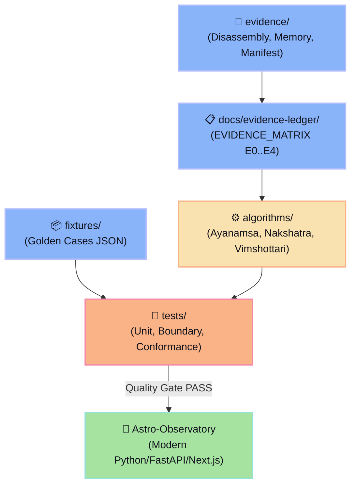

# 🧭 Jagannatha Hora RE (JH-RE) & Conformance Suite
> **Normative Architecture Specification:** [SPEC_ASTRO_OBSERVATORY_MODERNIZATION.md](file:///home/sukata/jagannatha_hora_re/SPEC_ASTRO_OBSERVATORY_MODERNIZATION.md)  
> **Target Subsystem:** Astrological Math Engine (`sweph32` bridge, Graha/Bhava/Varga data structures, FPU arithmetic, Vimshottari Dasha state machine)  
> **Role in Ecosystem:** Dossiê de evidências, fixtures e testes de conformidade para o **Astro-Observatory**

---

## 📌 Visão Geral da Arquitetura Refatorada

Conforme a especificação [SPEC_ASTRO_OBSERVATORY_MODERNIZATION.md](file:///home/sukata/jagannatha_hora_re/SPEC_ASTRO_OBSERVATORY_MODERNIZATION.md), o repositório opera sob a tese:

$$\text{JH-RE} = \text{conhecimento} + \text{evidências} + \text{especificações} + \text{fixtures}$$

$$\text{JH-RE} \xrightarrow{\text{conformance gates}} \text{Astro-Observatory (Runtime)}$$



---

## 📂 Navegação de Diretórios e Componentes

| Diretório / Arquivo | Descrição Técnica | Nível de Evidência / Status |
| :--- | :--- | :---: |
| [**SPEC_ASTRO_OBSERVATORY_MODERNIZATION.md**](file:///home/sukata/jagannatha_hora_re/SPEC_ASTRO_OBSERVATORY_MODERNIZATION.md) | Especificação normativa mestre (793 linhas) | **Normativo** |
| [**docs/evidence-ledger/EVIDENCE_MATRIX.md**](file:///home/sukata/jagannatha_hora_re/docs/evidence-ledger/EVIDENCE_MATRIX.md) | Matriz de rastreabilidade (Algoritmo × Evidência × Teste) | **E0..E4** |
| [**docs/discrepancies/DISCREPANCY_LOG.md**](file:///home/sukata/jagannatha_hora_re/docs/discrepancies/DISCREPANCY_LOG.md) | Registro de discrepâncias conhecidas (Ano solar vs Savana, etc.) | **Documentado** |
| [**docs/adr/**](file:///home/sukata/jagannatha_hora_re/docs/adr/README.md) | Catálogo de Architecture Decision Records (ADR-001 a ADR-010) | **Aprovado** |
| [**evidence/binary-manifest/MANIFEST.md**](file:///home/sukata/jagannatha_hora_re/evidence/binary-manifest/MANIFEST.md) | Perfil do binário PE32 e seções de memória Borland | **E2** |
| [**evidence/disassembly/**](file:///home/sukata/jagannatha_hora_re/evidence/disassembly/) | Desmontagens x87 FPU e despachante VCL Win32 | **E2** |
| [**algorithms/**](file:///home/sukata/jagannatha_hora_re/algorithms/) | Implementações puras e modulares (Ayanamsa, Nakshatra, Vimshottari) | **E3 / Validado** |
| [**fixtures/**](file:///home/sukata/jagannatha_hora_re/fixtures/) | Datasets golden normalizados (JSON) para validação diferencial | **E4 / Fixtures** |
| [**tests/**](file:///home/sukata/jagannatha_hora_re/tests/) | Suite automatizada de testes com pytest (13/13 testes aprovados) | **CI Green** |
| [**legacy/**](file:///home/sukata/jagannatha_hora_re/legacy/) | Artefatos de referência originais (Python e C++20) | **Preservado** |

---

## 🧪 Execução dos Testes Automatizados

Para executar toda a suite de conformidade:

```bash
python3 -m pytest -v
```

```text
============================== 13 passed in 0.43s ==============================
tests/boundary/test_boundaries.py::test_angle_normalization_boundaries PASSED
tests/boundary/test_boundaries.py::test_nakshatra_boundary_transitions PASSED
tests/boundary/test_boundaries.py::test_zodiac_wrap_boundary PASSED
tests/conformance/test_conformance.py::test_vimshottari_golden_cases PASSED
tests/unit/test_ayanamsha.py::test_j2000_base_ayanamsa PASSED
tests/unit/test_ayanamsha.py::test_sayana_nirayana_roundtrip PASSED
tests/unit/test_ayanamsha.py::test_spica_chitra_paksha PASSED
tests/unit/test_nakshatra.py::test_ashwini_pada1_start PASSED
tests/unit/test_nakshatra.py::test_bharani_pada_progression PASSED
tests/unit/test_nakshatra.py::test_revati_pada4_end PASSED
tests/unit/test_vimshottari.py::test_vimshottari_birth_balance PASSED
tests/unit/test_vimshottari.py::test_full_120_year_conservation PASSED
tests/unit/test_vimshottari.py::test_subperiod_antardashas PASSED
```

---

## 📜 Princípios Invariantes da Modernização

1. **Evidence before equivalence:** Nenhuma hipótese de engenharia reversa é considerada verdade sem testes diferenciais.
2. **Astronomy before astrology:** Separação estrita entre coordenadas físicas/efemérides, projeções e hermenêutica interpretativa.
3. **Explicit conventions:** Parâmetros de ayanamsha, sistema de casas, escala temporal e orbes devem ser explicitamente persistidos.
4. **Pure core, imperative shell:** Núcleo determinístico e testável, sem dependências de GUI ou banco de dados no domínio puro.
5. **Portable by construction:** Execução nativa em Linux/macOS/Docker sem qualquer dependência de Wine, Win32 ou PE32.
