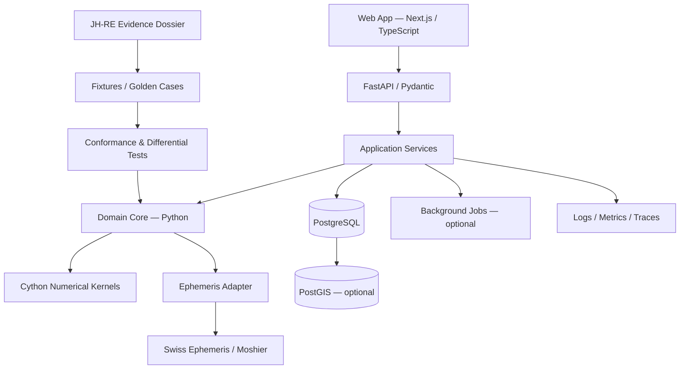

# SPEC — Astro-Observatory & Jagannatha Hora RE
## Modernização, integração e refatoração multiplataforma

**Status:** proposta arquitetural / implementação ainda não iniciada  
**Versão:** 1.0  
**Data:** 2026-11-09  
**Repositório de origem desta especificação:** `compilatorum/jagannatha-hora-re`  
**Escopo:** transformar o dossiê de engenharia reversa do Jagannatha Hora (JH-RE) e o projeto integrador Astro-Observatory em uma plataforma astrológica multiparadigma, reproduzível, web-native e independente de Windows.

---

## 0. Resumo executivo

Esta especificação define a evolução coordenada de dois artefatos:

1. **Jagannatha Hora RE (JH-RE):** preservar e qualificar o conhecimento de engenharia reversa sobre estruturas, algoritmos e comportamento do software legado. O repositório deixa de ser interpretado como um motor já comprovadamente reproduzido e passa a funcionar como **dossiê de evidências, fixtures e testes de conformidade**.
2. **Astro-Observatory:** construir o produto integrador, com motor astronômico e astrológico modular, API, persistência PostgreSQL e interface web. Ele consumirá implementações validadas do JH-RE, sem depender do executável original, de Win32, VCL, Borland C++ Builder ou de ferramentas proprietárias de desktop.

### Tese arquitetural

`JH-RE = conhecimento + evidências + especificações + fixtures`

`Astro-Observatory = runtime + serviços + dados + interface + experimentação`

`JH	ext{-}RE \xrightarrow{conformance\;gates} Astro\text{-}Observatory`

A modernização não deve converter automaticamente toda hipótese documentada em verdade de implementação. Cada algoritmo precisa de proveniência, testes de fronteira e, quando houver dados disponíveis, validação diferencial contra saídas de referência.

### Decisões principais

- **Python 3.12+** como linguagem de domínio, orquestração, API e integração.
- **Cython 3.x** para kernels numéricos e rotinas de alto custo, compilados para extensões nativas portáveis. Cython não substitui a camada de domínio Python: acelera partes medidas e estáveis.
- **TypeScript** para frontend web e contratos compartilhados.
- **PostgreSQL** como fonte persistente de verdade; **PostGIS** somente para recursos geoespaciais/astrocartográficos.
- **FastAPI + Pydantic** para API HTTP/OpenAPI.
- **React + Next.js** para aplicação web; visualizações SVG/Canvas/WebGL conforme necessidade.
- **SQLAlchemy 2 + Alembic** para persistência e migrações.
- **Docker/OCI + CI Linux** para builds reproduzíveis e execução sem Windows.
- **Swiss Ephemeris** como backend astronômico preferencial, sujeito a uma decisão formal de licença; **Moshier** como alternativa quando compatível com o escopo e a licença. O uso de Cython não elimina nem substitui a necessidade de um provedor de efemérides validado.
- **Wolfram não é dependência de runtime**. Cálculos determinísticos serão implementados em Python/Cython e/ou delegados a bibliotecas científicas abertas com contratos testáveis. Wolfram poderá existir apenas como ferramenta externa opcional de pesquisa, nunca como requisito de build, deploy ou execução.

---

## 1. Objetivos, não objetivos e princípios

### 1.1 Objetivos

- Eliminar dependência de Windows, Win32, PE32, VCL, Borland C++ Builder e executáveis proprietários no runtime final.
- Preservar o dossiê histórico e a trilha de evidências do JH-RE.
- Reimplementar e testar os componentes úteis em stack moderna.
- Integrar astrologia tropical/ocidental e Jyotish sem confundir seus formalismos.
- Separar astronomia observacional, transformações de coordenadas, convenções astrológicas e interpretação.
- Disponibilizar API, interface web, banco relacional, importação/exportação e documentação.
- Permitir execução local, em servidor Linux e em ambientes OCI.
- Construir uma base extensível para trânsitos, progressões, dashas, vargas, sinastria, estrelas fixas e camadas fenomenológicas.

### 1.2 Não objetivos da primeira entrega

- Reproduzir visualmente o desktop do Jagannatha Hora.
- Alegar equivalência total com JH sem corpus de referência e testes diferenciais.
- Implementar imediatamente todos os recursos astrológicos imagináveis.
- Tratar astrologia como causalidade cientificamente comprovada.
- Usar IA generativa para produzir posições planetárias ou substituir algoritmos astronômicos determinísticos.
- Adotar microserviços distribuídos antes de existir necessidade operacional mensurável.
- Fazer uma tradução mecânica de cada estrutura de memória do executável legado para tabelas SQL.

### 1.3 Princípios invariantes

1. **Evidence before equivalence:** documentação de engenharia reversa é hipótese até ser reproduzida.
2. **Astronomy before astrology:** primeiro calcular a posição astronômica; depois aplicar projeções e convenções.
3. **Explicit conventions:** ayanamsha, zodíaco, casas, efemérides, escala temporal e sistema de aspectos sempre explícitos.
4. **Reproducibility:** todo resultado deve registrar parâmetros, versões e proveniência.
5. **Pure core, imperative shell:** núcleo de cálculo determinístico e testável; I/O, API, banco e UI nas bordas.
6. **No silent coercion:** não converter automaticamente sistemas incompatíveis ou valores ausentes.
7. **Progressive fidelity:** iniciar com cálculos essenciais validados; ampliar cobertura sem sacrificar rastreabilidade.
8. **Portable by construction:** Linux/macOS como alvos primários; Windows não é requisito nem ambiente de desenvolvimento obrigatório.

---

## 2. Arquitetura de alto nível



### 2.1 Camadas

| Camada | Responsabilidade | Tecnologia |
|---|---|---|
| L0 — Astronomical substrate | Tempo, efemérides, posições, coordenadas | Python adapters; Swiss Ephemeris/Moshier |
| L1 — Coordinate transforms | Sayana/Nirayana, ayanamsha, geocêntrico/topocêntrico | Python + Cython após profiling |
| L2A — Western engine | Zodíaco tropical, casas, aspectos, pontos derivados | Python |
| L2B — Jyotish engine | Grahas, Bhavas, Nakshatras, Padas, Vargas, Drishti | Python |
| L3A — Temporal engine | Trânsitos, progressões, retornos | Python |
| L3B — Dasha engine | Vimshottari e subdivisões | Python + Cython se necessário |
| L4 — Relational geometry | Sinastria, composite, estrelas fixas, parans | Python |
| L5 — Phenomenological observatory | Diário, observações, correlações exploratórias, HITL | API + PostgreSQL |
| L6 — Interpretive intelligence | Heurísticas, explicações, hipóteses e IA | Serviços isolados, sempre downstream dos cálculos |
| L7 — Presentation | Charts, timelines, dashboards, editor de mapas | Next.js / TypeScript |

**Regra:** L6 nunca altera silenciosamente os resultados de L0–L5. Toda interpretação generativa deve apontar para os dados e convenções usados.

### 2.2 Modular monolith primeiro

A primeira arquitetura será um **monólito modular** com fronteiras internas explícitas. Separar serviços apenas quando escala, isolamento, implantação ou propriedade de dados justificarem o custo. O deploy inicial deve caber em um único serviço API, um banco PostgreSQL e, opcionalmente, um worker.

---

## 3. Stack tecnológica normativa

### 3.1 Backend

- Python 3.12 ou superior, com versão fixada por projeto.
- Cython 3.x para extensões nativas selecionadas.
- FastAPI para HTTP e OpenAPI.
- Pydantic v2 para validação de DTOs e configurações.
- SQLAlchemy 2.x para ORM/SQL; Alembic para migrações.
- NumPy para vetorização e interoperabilidade numérica quando adequado.
- SciPy somente para rotinas cuja necessidade esteja demonstrada.
- pytest, Hypothesis e coverage para testes.
- Ruff para lint/format; mypy ou pyright para análise estática.
- uv ou Poetry (escolher um gerenciador e padronizar lockfiles; recomendação inicial: uv).

### 3.2 Cython: política de uso

Cython é uma camada de aceleração, não uma segunda implementação autônoma do domínio.

**Aplicar Cython quando:**
- profiling comprovar gargalo CPU-bound;
- a função for determinística, isolável e coberta por testes;
- tipos e limites numéricos estiverem documentados;
- existir benchmark Python puro versus Cython.

**Não aplicar Cython quando:**
- o custo for dominado por I/O, banco ou chamadas de efemérides;
- o código mudar frequentemente;
- a otimização reduzir legibilidade sem ganho material;
- não houver testes de equivalência.

**Contrato de implementação:**
- API pública Python permanece estável;
- versão Python pura é referência semântica;
- extensão Cython é intercambiável e opcional em ambiente de desenvolvimento;
- fallback puro deve existir para instalação sem compilador;
- não usar flags de compilação que relaxem precisão IEEE-754 sem justificativa e testes;
- nunca expor ponteiros ou layouts de memória do executável legado como contrato público.

### 3.3 Frontend

- TypeScript com strict mode.
- Next.js/React para aplicação web.
- TanStack Query ou mecanismo equivalente para estado remoto.
- Zod para validação de contratos no cliente quando útil.
- SVG para mapas astrológicos e geometrias vetoriais; Canvas/WebGL apenas para visualizações com volume que justifique.
- Storybook opcional para catálogo de componentes.
- Playwright para testes E2E.

A UI deve mostrar claramente o sistema de referência: tropical/sidereal, ayanamsha, casas, local, instante e fuso horário.

### 3.4 Dados e infraestrutura

- PostgreSQL como banco primário.
- PostGIS opcional para coordenadas geográficas, trajetórias e astrocartografia.
- Redis opcional, apenas se houver necessidade de cache distribuído, filas ou coordenação.
- Jobs inicialmente via worker simples; Celery/RQ/Dramatiq somente após justificar.
- Docker/OCI para desenvolvimento e produção.
- GitHub Actions em runners Linux.
- Observabilidade por logs estruturados e métricas; OpenTelemetry pode ser introduzido incrementalmente.

### 3.5 Linguagens e artefatos

| Uso | Linguagem/formato |
|---|---|
| Domínio, API, jobs | Python |
| Kernels numéricos | Cython (`.pyx` + interfaces Python) |
| Frontend | TypeScript / TSX |
| Banco e consultas | SQL / PostgreSQL |
| Contratos HTTP | OpenAPI / JSON |
| Configuração | TOML / YAML / JSON Schema |
| Documentação e ADRs | Markdown |
| Diagramas | Mermaid |
| Test fixtures | JSON / CSV / Parquet quando apropriado |

C++ legado pode permanecer apenas como artefato de referência histórica ou comparador temporário. Não deve ser dependência de runtime nem requisito para compilar o sistema principal.

---

## 4. Refatoração coordenada dos dois projetos

### 4.1 JH-RE — de dossiê de RE para pacote de conformidade

**Preservar:**
- documentos atuais de layout de memória, fluxo de cálculo, matemática/ayanamsha/nakshatra e Vimshottari;
- código Python e C++ original como artefatos de referência, sem atribuir a eles status de equivalência comprovada;
- comandos e observações de Radare2 como trilha histórica.

**Adicionar:**
- classificação de evidência por afirmação;
- referências a endereço, função, trecho, hash e artefato de origem quando disponíveis;
- fixtures normalizadas;
- testes de fronteira;
- testes diferenciais;
- registro de discrepâncias;
- matriz de cobertura algoritmo × evidência × implementação × teste.

**Classificação de evidência:**
- E0 — hipótese ou inferência;
- E1 — evidência documental;
- E2 — evidência direta do binário (dump, disassembly, xrefs, hash);
- E3 — reprodução independente;
- E4 — validação diferencial com saídas de referência.

Não promover E0/E1 a E3/E4 sem artefatos verificáveis.

### 4.2 Astro-Observatory — novo runtime

Astro-Observatory será o produto de execução. Ele não deve importar arquivos de memória do JH-RE nem acoplar-se a classes legadas. A integração ocorrerá por contratos de domínio, fixtures e testes de conformidade.

**Responsabilidades:**
- calcular posições astronômicas;
- projetar posições em sistemas astrológicos distintos;
- calcular relações e períodos;
- persistir configurações e resultados;
- expor API e interface web;
- registrar interpretações e observações do usuário sem misturá-las com dados astronômicos.

### 4.3 Limite entre os repositórios

- JH-RE mantém pesquisa, evidências, algoritmos reconstruídos, fixtures e histórico.
- Astro-Observatory mantém runtime, API, UI, migrações e serviços.
- Uma biblioteca Python compartilhada poderá ser extraída somente após interfaces estabilizadas; inicialmente, copiar código é proibido, mas dependência direta do dossiê também é evitada. O código de produção deve ser implementado no pacote de domínio do Astro-Observatory e ligado às fixtures do JH-RE.
- Toda transferência de algoritmo deve referenciar o documento/fixture de origem e seu nível de evidência.

---

## 5. Modelo de domínio e contratos de dados

### 5.1 Entidades fundamentais

**AstronomicalPosition**
- body_id
- instant_utc
- time_scale (UT1/UTC/TT conforme operação)
- longitude_deg
- latitude_deg
- distance_au ou unidade declarada
- longitude_speed_deg_per_day
- latitude_speed_deg_per_day
- declination_deg
- right_ascension_deg
- coordinate_frame
- origin (geocentric/topocentric/heliocentric)
- ephemeris_provider
- provider_version

**AstrologicalProjection**
- astronomical_position_id
- zodiac_mode (tropical/sidereal)
- ayanamsha_id (nulo para tropical)
- sidereal_longitude_deg
- sign_id
- sign_degree
- house_system
- house_number (quando aplicável)
- nakshatra_id (quando aplicável)
- pada (quando aplicável)
- calculation_profile_id

**AstrologicalRelationship**
- source_object_id
- target_object_id
- relation_type (aspect/drishti/conjunction/fixed_star/transit/synastry etc.)
- exact_angle_deg
- orb_deg
- applying_or_separating (quando calculável)
- convention_id
- timestamp

**CalculationProfile**
- nome e versão do perfil;
- efemérides e versão;
- ayanamsha;
- sistema de casas;
- zodíaco;
- opções geocêntricas/topocêntricas;
- regras de arredondamento;
- convenções de tempo;
- configuração de aspectos/Drishti.

### 5.2 Separação obrigatória

`AstronomicalPosition \neq AstrologicalProjection \neq Interpretation`

A posição astronômica é dado calculado por modelo físico/efeméride. A projeção astrológica depende de convenções. A interpretação é uma camada hermenêutica e deve ser registrada como tal.

### 5.3 Precisão e unidades

- Armazenar valores angulares em graus decimais com precisão suficiente; definir precisão e arredondamento por contrato.
- Usar UTC como representação persistida do instante, conservando timezone IANA e horário civil original do evento.
- Não usar strings formatadas como fonte de cálculo.
- Não arredondar antes de calcular aspectos, casas, nakshatras, padas ou dashas.
- Distinguir longitude eclíptica, latitude eclíptica, declinação e ascensão reta.
- Distinguir cusp, bhava madhya, sandhi e limites de casa; não os reduzir a um único campo.
- Registrar unidades em nomes de campos ou schemas.

---

## 6. Motor astronômico e projeções

### 6.1 Ephemeris Adapter

Criar uma interface interna independente do fornecedor:

- `get_body_state(body, instant, observer, frame, flags)`
- `get_houses(instant, latitude, longitude, house_system, flags)`
- `get_ayanamsha(instant, model)` quando fornecido pelo backend; caso contrário, usar implementação isolada e validada.

A interface deve retornar valores tipados, metadados de origem e erros explícitos. Não permitir fallback silencioso entre Swiss Ephemeris e Moshier sem registrar a mudança de provedor.

### 6.2 Licenciamento

Antes de distribuir binários ou oferecer serviço hospedado com Swiss Ephemeris, fazer análise jurídica/técnica da licença aplicável (AGPL ou licença comercial, conforme uso e distribuição). Documentar decisão no ADR. O projeto deve poder selecionar outro backend compatível por adapter, mas não prometer equivalência numérica sem testes.

### 6.3 Dual Zodiac Coordinate Engine

Implementar dois modos explícitos:

- **Sayana/tropical:** longitude tropical;
- **Nirayana/sidereal:** longitude tropical ajustada pelo ayanamsha escolhido, com convenção documentada.

[
\lambda_{nirayana} = (\lambda_{sayana} - A(t)) \bmod 360^\circ
]

Ayanamsha é parâmetro versionado. Lahiri/Chitrapaksha, Raman, Krishnamurti e outros modelos devem ser entradas distintas, não aliases. Registrar versão, epoch, fórmula e fonte. Criar testes de fronteira em 0°/360° e nos limites de signo.

### 6.4 Casas

- Suportar Placidus e Whole Sign como prioridades iniciais.
- Manter adapter para outros sistemas, sem inferir equivalência.
- Persistir cusps, centros e sandhis em campos distintos.
- Registrar coordenadas geográficas, altitude quando disponível, sistema de casas e tratamento de latitudes extremas.
- Whole Sign deve ser uma projeção selecionável, não substituição silenciosa do mapa Placidus.

### 6.5 Nakshatra e Pada

- Divisão padrão em 27 nakshatras de 13°20′ cada, com origem e convenção explícitas.
- Padas de 3°20′.
- Implementar normalização angular robusta e testes exatos nos limites.
- Opcionalmente modelar Abhijit como extensão independente; não alterar a grade de 27 silenciosamente.

### 6.6 Varga / Shodashavarga

- Modelar regras de divisão por varga como funções puras e versionadas.
- Priorizar D-1, D-9 e D-10 para primeira cobertura; depois ampliar para conjunto de 16 e demais divisões.
- Cada varga deve registrar algoritmo, convenção e limites.
- Não tratar vargas como progressões temporais.

### 6.7 Vimshottari Dasha

- Implementar sequência de senhores, duração total e cálculo de saldo inicial a partir da longitude lunar/nakshatra.
- Suportar níveis recursivos de períodos com API uniforme.
- Tornar convenção de ano (por exemplo, ano sideral de 365,25 ou convenção específica do sistema) configurável e registrada.
- Testar soma de durações, continuidade, ausência de sobreposição e comportamento nas fronteiras.
- Confrontar implementação Python e extensão Cython com os mesmos fixtures.
- A versão C++ existente é referência histórica; não é oracle sem validação.

### 6.8 Motor ocidental

- Aspectos por separação angular mínima e catálogo configurável.
- Orbs específicos por aspecto e por perfil.
- Distinguir aspecto exato, aplicante e separante quando houver velocidades disponíveis.
- Pontos derivados: Lilith média/verdadeira, Quíron, Parte da Fortuna, Parte do Espírito, Vertex e outros, cada um com definição e parâmetros.
- Não inferir conjunção apenas por signo comum.
- Progressões secundárias, retornos e sinastria em módulos separados.

### 6.9 Relações e estrelas fixas

- Catálogo de estrelas com fonte, época, sistema de coordenadas e magnitude quando disponível.
- Precessão/nutação e movimento próprio tratados de modo explícito.
- Conjunções com estrelas fixas calculadas por distância angular e orbe configurável.
- Declinação paralela, contraparalela, antiscia, parans e astrocartografia são módulos posteriores e independentes.

---

## 7. API e experiência web

### 7.1 Endpoints iniciais

- `GET /health`
- `GET /api/v1/calculation-profiles`
- `POST /api/v1/calculations/natal`
- `POST /api/v1/calculations/transits`
- `POST /api/v1/calculations/dasha/vimshottari`
- `POST /api/v1/calculations/synastry` (fase posterior)
- `GET /api/v1/charts/{chart_id}`
- `GET /api/v1/charts/{chart_id}/positions`
- `GET /api/v1/charts/{chart_id}/relationships`
- `GET /api/v1/charts/{chart_id}/timeline`
- `POST /api/v1/observations`

### 7.2 Requisitos de API

- OpenAPI gerado e versionado.
- Schemas de entrada e saída explícitos.
- Erros de cálculo distinguíveis de erros de validação.
- Idempotência em operações de cálculo persistidas.
- Paginação para séries temporais.
- Limites de payload, timeouts e rate limits configuráveis.
- Nenhum segredo ou credencial em logs.
- Toda resposta de cálculo inclui `calculation_profile`, `engine_versions` e `provenance`.

### 7.3 UI — telas prioritárias

1. Perfil de cálculo: zodíaco, ayanamsha, casas, efemérides e local.
2. Cadastro de evento natal: data/hora civil, timezone IANA, latitude/longitude, fonte e incerteza do horário.
3. Mapa natal: visualização ocidental e Jyotish em painéis independentes.
4. Tabela de posições: Sayana/Nirayana lado a lado.
5. Nakshatra/Pada/Varga e dignidades com convenções visíveis.
6. Linha temporal: transitos e Vimshottari em trilhas distintas.
7. Comparador de perfis: mesma base astronômica, projeções distintas.
8. Diário fenomenológico/HITL: observações do usuário sem inferência causal automática.

---

## 8. Persistência PostgreSQL

### 8.1 Tabelas iniciais

- `users` (se houver autenticação na primeira release);
- `birth_events`;
- `locations`;
- `calculation_profiles`;
- `calculation_runs`;
- `astronomical_positions`;
- `astrological_projections`;
- `house_cusps`;
- `house_centers`;
- `nakshatra_positions`;
- `varga_positions`;
- `relationships`;
- `dasha_periods`;
- `fixed_stars`;
- `observations`;
- `interpretations`;
- `provenance_records`.

### 8.2 Regras de persistência

- UUIDs como identificadores públicos; chaves internas adequadas ao PostgreSQL.
- `timestamptz` para instantes absolutos; armazenar timezone IANA e horário local original separadamente.
- `numeric` para valores que exigem representação decimal controlada; `double precision` apenas quando a natureza numérica e os testes justificarem.
- JSONB para parâmetros versionados e metadados extensíveis, não para substituir tabelas relacionais centrais.
- Índices por evento, instante, corpo, perfil e tipo de relação.
- Constraints para ranges válidos, unicidade e integridade referencial.
- Migrações Alembic revisadas; nunca editar schema de produção manualmente sem migração.
- Dados pessoais e dados de nascimento protegidos por política de acesso, retenção e exportação.

---

## 9. Testes, validação e qualidade

### 9.1 Pirâmide de testes

- **Unitários:** normalização angular, ayanamsha, casas, nakshatra/pada, vargas, aspectos e dashas.
- **Property-based:** invariantes matemáticos, periodicidade de 360°, monotonicidade de períodos e conservação de durações.
- **Golden tests:** fixtures versionadas derivadas de fontes conhecidas.
- **Differential tests:** comparação com Jagannatha Hora ou outra implementação de referência, somente quando a saída e os parâmetros forem conhecidos.
- **Integration:** adapter de efemérides, PostgreSQL, API.
- **E2E:** fluxos de cadastro, cálculo, comparação e visualização.
- **Performance:** benchmarks separados para Python puro, Cython e chamadas externas.

### 9.2 Golden dataset

Criar fixtures independentes de usuários reais, cobrindo:
- datas próximas a mudança de signo;
- limites de nakshatra/pada;
- retrogradação e estações;
- latitudes elevadas;
- fusos com mudanças históricas;
- datas bissextas e transições de calendário;
- casas em latitudes extremas;
- períodos de dasha com fronteiras exatas.

O mapa pessoal do proprietário do projeto pode ser um caso privado de validação, não um fixture público por padrão. Divergência de horário de nascimento deve ser registrada como incerteza e nunca resolvida por suposição.

### 9.3 Tolerâncias

Cada teste diferencial deve declarar:
- grandeza comparada;
- unidade;
- precisão esperada;
- tolerância absoluta/relativa;
- parâmetros do cálculo;
- fonte de referência;
- motivo de divergência aceitável.

Não definir uma tolerância universal para todos os cálculos.

### 9.4 Quality gates

CI deve falhar em:
- testes unitários ou de integração;
- formatação/lint;
- análise de tipos acordada;
- migrações inválidas;
- build da extensão Cython em Linux;
- build sem extensão (fallback Python);
- dependência acidental de caminho Windows;
- import de módulo de UI dentro do core;
- uso de Wolfram como runtime dependency;
- alteração de fixture sem explicação de proveniência.

---

## 10. Segurança, privacidade, licenças e operação

- Segredos exclusivamente em variáveis de ambiente/secret manager.
- Autenticação e autorização antes de armazenar dados pessoais multiusuário.
- Criptografia em trânsito; criptografia em repouso conforme infraestrutura.
- Política de exportação e exclusão de dados pessoais.
- Minimização de dados: localização de nascimento não deve ser coletada além do necessário.
- Auditoria de dependências e SBOM.
- Licenças de Swiss Ephemeris, bibliotecas frontend e pacotes Python verificadas antes de redistribuição.
- O dossiê de RE deve evitar incluir binários proprietários, dumps protegidos ou conteúdo cuja redistribuição não seja autorizada.
- Separar documentação de engenharia reversa, código original e reimplementação independente.
- Não alegar endosso, afiliação ou equivalência oficial com Jagannatha Hora.

---

## 11. Estrutura de diretórios proposta

### Astro-Observatory

```text
astro-observatory/
  apps/
    api/
    web/
    worker/
  packages/
    astro_domain/
      astronomy/
      coordinates/
      western/
      jyotish/
      temporal/
      relational/
      fixed_stars/
      phenomenology/
      interpretation/
    astro_compute/
      kernels/
      adapters/
      cython/
    astro_persistence/
      models/
      repositories/
      migrations/
    astro_contracts/
      schemas/
      openapi/
  tests/
    unit/
    property/
    golden/
    differential/
    integration/
    e2e/
    benchmarks/
  data/
    fixtures/
    catalogs/
  docs/
    adr/
    architecture/
    operations/
  infra/
    docker/
    compose/
    github/
  pyproject.toml
  uv.lock
  README.md
```

### JH-RE

```text
jagannatha-hora-re/
  evidence/
    binary-manifest/
    disassembly/
    memory-layout/
    call-graphs/
  algorithms/
    ayanamsha/
    nakshatra/
    vimshottari/
  fixtures/
    positions/
    houses/
    dashas/
  tests/
    unit/
    boundary/
    differential/
    conformance/
  docs/
    current-dossier/
    evidence-ledger/
    discrepancies/
  legacy/
    reference-python/
    reference-cpp/
  SPEC_ASTRO_OBSERVATORY_MODERNIZATION.md
```

A reorganização do JH-RE deve ser gradual. Não mover nem apagar os arquivos atuais antes de atualizar links, referências e histórico.

---

## 12. Plano de execução por fases

### Fase 0 — Baseline e governança (P0)
- Inventariar todos os arquivos e afirmações do JH-RE.
- Identificar o que é evidência, inferência ou exemplo ilustrativo.
- Registrar hash e origem de artefatos que possam ser legalmente mantidos.
- Definir ADRs: licença de efemérides, Python/Cython, banco, API, frontend e monólito modular.
- Estabelecer convenções de tempo, coordenadas, unidades e precisão.

**Aceite:** inventário revisado; decisões registradas; nenhuma hipótese crítica apresentada como fato validado.

### Fase 1 — Core astronômico e contratos (P1)
- Criar pacote Python de domínio.
- Implementar modelos tipados e adapters de efemérides.
- Construir testes de Julian Day/timezone e posições.
- Implementar Sayana/Nirayana com ayanamsha configurável.
- Criar fixtures golden iniciais.

**Aceite:** cálculos repetíveis com perfil completo e proveniência.

### Fase 2 — Jyotish mínimo (P2)
- Graha, Bhava e casas.
- Nakshatra/Pada.
- Varga D-1, D-9 e D-10.
- Vimshottari com recursão multinível.
- Conformidade Python puro e Cython.

**Aceite:** invariantes e fixtures passam; discrepâncias documentadas.

### Fase 3 — Motor ocidental e geometria relacional (P3)
- Casas Placidus/Whole Sign.
- Aspectos e orbes.
- Pontos derivados.
- Trânsitos e sobreposição com mapa natal.
- Sinastria inicial.

**Aceite:** geometria testada e convenções expostas na API.

### Fase 4 — Persistência e API (P4)
- PostgreSQL, SQLAlchemy e Alembic.
- Endpoints de cálculo e consulta.
- Proveniência persistida.
- Testes de integração e segurança.

**Aceite:** instalação OCI reproduzível e API documentada.

### Fase 5 — Web Observatory (P5)
- Perfil de cálculo e cadastro de evento.
- Mapas natal e tabelas.
- Comparação tropical/sidereal.
- Timeline de trânsitos e dashas.
- Observações HITL.

**Aceite:** jornada principal utilizável no browser, responsiva e acessível.

### Fase 6 — Otimização e recursos avançados (P6)
- Profiling real.
- Cython somente nos gargalos demonstrados.
- Estrelas fixas, declinação, parans, astrocartografia.
- Progressões, retornos e módulos experimentais.
- IA interpretativa com referências a cálculos e incerteza.

**Aceite:** benchmarks publicados; nenhum ganho de performance sacrifica precisão sem decisão documentada.

---

## 13. Critérios de aceitação globais

O projeto estará pronto para primeira release quando:

1. Executar integralmente em Linux sem Wine, Win32, VCL ou binários Windows.
2. Instalar dependências a partir de lockfile e construir imagem OCI reproduzível.
3. Calcular posições por adapter astronômico com provedor e versão registrados.
4. Oferecer projeções tropical e sidereal sem misturar seus parâmetros.
5. Implementar Nakshatra/Pada e Vimshottari com testes de fronteira.
6. Ter backend FastAPI, PostgreSQL e frontend web funcional.
7. Ter fallback Python puro quando extensão Cython não estiver compilada.
8. Passar CI em Linux para build puro e build Cython.
9. Expor proveniência e convenções em toda resposta de cálculo.
10. Manter o JH-RE como trilha de evidências e não como dependência proprietária.
11. Documentar licenças de todas as dependências distribuídas.
12. Não atribuir validade científica causal a interpretações astrológicas.

---

## 14. ADRs obrigatórios antes de implementação

| ADR | Decisão | Questão a resolver |
|---|---|---|
| ADR-001 | Efemérides | Swiss Ephemeris AGPL/comercial versus alternativa |
| ADR-002 | Cython | Quais kernels realmente precisam de aceleração |
| ADR-003 | Tempo | UTC, UT1, TT, Delta-T e timezone IANA |
| ADR-004 | Ayanamsha | Modelos, fontes, épocas e precisão |
| ADR-005 | Casas | Semântica de cusp, madhya, sandhi e Whole Sign |
| ADR-006 | Persistência | Numeric versus float, versionamento de resultados |
| ADR-007 | API | Versionamento, idempotência e autenticação |
| ADR-008 | Frontend | Next.js, biblioteca de gráficos e estratégia de estado |
| ADR-009 | Licenças | Compatibilidade de todas as dependências |
| ADR-010 | Integração | Como fixtures do JH-RE são consumidas pelo Astro-Observatory |

---

## 15. Riscos e metacrítica arquitetural

| Risco | Consequência | Mitigação |
|---|---|---|
| Tratar RE como verdade | Reprodução incorreta | Evidence ledger e testes diferenciais |
| Cython prematuro | Complexidade e manutenção | Profiling e fallback Python |
| Licença inadequada de efemérides | Restrição de distribuição | ADR jurídico antes do release |
| Misturar astronomia e interpretação | Resultados opacos | Camadas e schemas separados |
| Big-bang rewrite | Perda de conhecimento | Migração incremental e preservação do legado |
| Microserviços prematuros | Operação complexa | Monólito modular |
| Precisão aparente | Falsa confiança | Incerteza, proveniência e tolerâncias explícitas |
| Banco como modelo de domínio | Acoplamento | Core independente de ORM |
| IA gerar cálculo | Não determinismo | IA somente downstream |

### Formalismo de controle

[
\text{Trust}(r) = f(\text{provenance},\text{reproducibility},\text{validation},\text{uncertainty})
]

[
\text{Calculation} \rightarrow \text{Projection} \rightarrow \text{Relationship} \rightarrow \text{Interpretation}
]

Aumentar a resolução do mapa ou o número de técnicas não aumenta automaticamente a confiabilidade da interpretação. Mais parâmetros exigem mais validação e maior explicitação de incerteza.

---

## 16. Definição de pronto para cada módulo

Um módulo só é considerado pronto quando possui:

- contrato público e tipos;
- convenções documentadas;
- implementação de referência Python;
- implementação Cython apenas se houver benchmark justificando;
- testes unitários, de propriedade e fronteira;
- fixtures e proveniência;
- documentação de limitações;
- API/UI que exponha os parâmetros relevantes;
- migrações, quando houver persistência;
- logs sem dados pessoais desnecessários.

---

## 17. Próximas ações imediatas

1. Criar o repositório Astro-Observatory ou confirmar o repositório já existente que será seu destino.
2. Adicionar esta especificação como documento normativo de arquitetura no JH-RE.
3. Criar ADR-001 para licença/seleção de efemérides antes de implementar o adapter.
4. Criar matriz de evidências e fixtures para Nakshatra, Ayanamsha e Vimshottari.
5. Inicializar o monólito modular Python/FastAPI/PostgreSQL/Next.js em branch própria.
6. Portar primeiro os algoritmos de maior valor e menor ambiguidade; manter o código C++ como comparador temporário.
7. Não iniciar otimização Cython até existir benchmark reproduzível do código Python puro.

**Resultado esperado:** uma plataforma astrológica computacional, aberta a múltiplas tradições e convenções, com cálculo determinístico, rastreabilidade e interface web — preservando o trabalho de engenharia reversa como patrimônio técnico verificável, sem herdar a dependência tecnológica do software legado.
