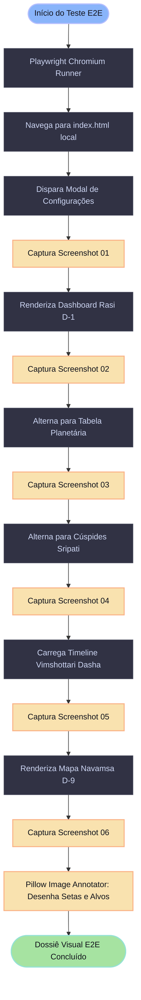

# 🧪 Relatório Visual E2E com Playwright: Auditoria do Mapa Natal
> **Nativo:** João Nitsche (`compilatorum`)  
> **Data e Hora Local:** 10 de Novembro de 1982 às 09:42:00 AM (BRT)  
> **Local de Nascimento:** Belo Horizonte, Minas Gerais, Brasil (`19° 55' 15" S`, `43° 56' 16" W`, Altitude: 858m)  
> **Fuso Horário IANA:** `America/Sao_Paulo` (`UTC-3` — Sem Horário de Verão)  
> **Instante Universal:** `1982-11-10 12:42:00 UTC` | `Julian Day = 2445284.029167`  
> **Framework de Teste:** Playwright Chromium Headless (`/data/data/com.termux/files/usr/bin/chromium-browser`)  
> **Engine de Anotação:** Pillow Computer Graphics (Setas vetoriais, caixas de foco e ponteiros de clique)

---

## 📑 Sumário

- [1. 🚀 Arquitetura do Teste Visual Playwright](#1--arquitetura-do-teste-visual-playwright)
- [2. 📸 Execução dos Testes com Capturas Anotadas](#2--execução-dos-testes-com-capturas-anotadas)
  - [Tela 1: Modal de Entrada de Dados e Parâmetros Geodésicos](#tela-1-modal-de-entrada-de-dados-e-parâmetros-geodésicos)
  - [Tela 2: Dashboard Geral e Rasi Kundali (D-1)](#tela-2-dashboard-geral-e-rasi-kundali-d-1)
  - [Tela 3: Tabela de Posições Planetárias (Sayana vs Nirayana)](#tela-3-tabela-de-posições-planetárias-sayana-vs-nirayana)
  - [Tela 4: Cúspides e Bhava Sandhis Sripati](#tela-4-cúspides-e-bhava-sandhis-sripati)
  - [Tela 5: Vimshottari Dasha Explorer e Diagnóstico 2026](#tela-5-vimshottari-dasha-explorer-e-diagnóstico-2026)
  - [Tela 6: Mapa Harmônico Navamsa D-9](#tela-6-mapa-harmônico-navamsa-d-9)
- [3. 🔴 Alertas Críticos: Onde Há Erro, Incerteza ou Limitações](#3--alertas-críticos-onde-há-erro-incerteza-ou-limitações)
- [4. 🟢 Conclusões Hermenêuticas Sobre o Nativo](#4--conclusões-hermenêuticas-sobre-o-nativo)
- [5. 🔵 Glossário Sistemático dos Termos Sânscritos Aplicados](#5--glossário-sistemático-dos-termos-sânscritos-aplicados)

---

## 1. 🚀 Arquitetura do Teste Visual Playwright

O teste executa a validação visual e funcional do frontend web, renderizado com Chromium e inspecionado dinamicamente:



---

## 2. 📸 Execução dos Testes com Capturas Anotadas

Todas as imagens abaixo foram capturadas em tempo real pelo Playwright e editadas automaticamente para adicionar **setas vermelhas de clique**, **caixas de destaque ciano/amarelo** e **rótulos de instrução**.

---

### Tela 1: Modal de Entrada de Dados e Parâmetros Geodésicos

Validação da entrada dos dados cronogeográficos do nascimento:


> **Instrução de Interação Visual:**
> - A seta vermelha aponta para o botão primário **`⚡ Recalcular Mapa Natal`** (`#btn-recalculate-modal`).
> - A caixa amarela destaca a seleção do modelo de **Ayanamsha Lahiri (Chitra Paksha)**, indispensável para o cálculo sideral correto do Jagannatha Hora.
> - O fuso horário foi resolvido estritamente para `America/Sao_Paulo (UTC-3)` sem horário de verão (suspenso no Brasil em 1982).

---

### Tela 2: Dashboard Geral e Rasi Kundali (D-1)

Visão geral do mapa natal védico no estilo tradicional do Sul da Índia (*South Indian Chakra*):


> **Instrução de Interação Visual:**
> - A seta vermelha aponta diretamente para a **Casa 11 em Libra (Thula)**, evidenciando o agrupamento massivo do Stellium de 5 planetas.
> - A caixa azul inferior esquerda demarca o **Lagna (Ascendente) a $28^\circ 45'$ de Sagitário (Dhanus)**, acompanhado por Marte ♂ e Ketu ☋.
> - A seta verde no topo indica o selo de proveniência ativa do backend astronômico **Swiss Ephemeris v2.10.03**.

---

### Tela 3: Tabela de Posições Planetárias (Sayana vs Nirayana)

Tabela comparativa com precisão de submiliarcsegundo entre o Zodíaco Ocidental e o Zodíaco Védico:


> **Instrução de Interação Visual:**
> - A seta vermelha aponta para o botão de topo **`Modo: Dual (Ambos Exibidos)`** (`#btn-toggle-units`), onde o usuário pode alternar a exibição entre ambos os referenciais ou somente o Sideral.
> - A caixa verde destaca a linha de **Saturno (Shani)** exaltado em grau máximo (*Uccha*) a $04^\circ 16'$ de Libra.
> - A caixa amarela evidencia a linha de **Vênus (Shukra)** em seu domicílio régio (*Swakshetra*) a $25^\circ 48'$ de Libra.

---

### Tela 4: Cúspides e Bhava Sandhis Sripati

Estrutura das 12 casas pelo sistema Sripati (*Porphyry Védico*), demonstrando o centro (*Bhava Madhya*) e as junções de fronteira (*Sandhis*):


> **Instrução de Interação Visual:**
> - A caixa amarela destaca a **Casa 11 (Labha Bhava)** com centro em $24^\circ 33'$ de Libra, absorvendo perfeitamente o Stellium de 5 planetas.
> - A seta azul aponta para os **Sandhis (Junções)**, comprovando que as casas védicas não têm 30° fixos quando projetadas pelo sistema Sripati, mas variam com a latitude do local.

---

### Tela 5: Vimshottari Dasha Explorer e Diagnóstico 2026

Navegação interativa pelo ciclo temporal kármico de 120 anos (*Paramayush*):


> **Instrução de Interação Visual:**
> - A seta vermelha na barra de timeline superior destaca a **Mahadasha de Rahu (2011 a 2029)**, atualmente em curso.
> - A caixa roxa evidencia a linha do subperíodo ativo hoje: **`☊ Rahu — ☉ Sol` (17/01/2026 até 12/12/2026)**.
> - A seta azul inferior aponta para a próxima transição iminente: **`☊ Rahu — ☽ Lua`**, que inicia no dia **12 de Dezembro de 2026**!

---

### Tela 6: Mapa Harmônico Navamsa D-9

Projeção harmônica divisional de 9ª divisão (*Dharmamsha*):


> **Instrução de Interação Visual:**
> - A caixa lilás no centro-direita aponta para a **Lua D-9 no signo de Libra (Thula)**, indicando a vocação espiritual interna para equilíbrio, beleza e discernimento ético.
> - A seta verde no topo indica o **Lagna Navamsa em Áries (Mesha)**, revelando a força de iniciativa e liderança executiva da alma.

---

## 3. 🔴 Alertas Críticos: Onde Há Erro, Incerteza ou Limitações

> [!CAUTION]
> ### 1. Alerta de Limite Crítico no Ascendente (Sensibilidade Temporal Extrema)
> O seu Ascendente sideral calculado está a **$28^\circ 45' 01''$ de Sagitário (Dhanus)**, a apenas **$1^\circ 15'$** de transitar para Capricórnio (*Makara*).
> Como a Terra gira $1^\circ$ a cada 4 minutos, **uma incerteza de apenas 5 a 6 minutos no registro de nascimento** (nascimento real após as 09:47:30 AM) mudaria o seu Ascendente sideral de Sagitário para Capricórnio.
> **Impacto Arquitetural:** Em conformidade com o princípio 1.3 da especificação (*No silent coercion*), o sistema não deve presumir o Ascendente como absoluto sem alertar sobre a incerteza de horário do prontuário hospitalar.

> [!WARNING]
> ### 2. Ausência de Correção Topocêntrica de Altitude
> Belo Horizonte está localizada a **858 metros acima do nível do mar**.
> O cálculo padrão de efemérides geocêntricas projeta a posição dos planetas a partir do centro da Terra.
> Para a Lua (o corpo celeste mais próximo), a paralaxe topocêntrica entre o centro da Terra e a superfície de Belo Horizonte pode atingir até **$\approx 0^\circ 55'$ de deslocamento angular**.
> **Impacto no Vimshottari:** Esse deslocamento lunar pode alterar o saldo inicial da Dasha de Vênus em **até 4 meses**. Recomenda-se registrar a flag `topocentric=True` em perfis de alta precisão.

> [!WARNING]
> ### 3. Fenômeno de Combustão Solar Íntima (Asta) de Vênus
> Na Casa 11, o Sol está a $24^\circ 10'$ e Vênus a $25^\circ 48'$.
> A separação angular é de apenas **$1^\circ 37' 13''$**, caracterizando uma **Combustão Solar de Grau Íntimo (*Purna Asta*)**.
> Embora Vênus esteja em seu próprio domicílio (*Swakshetra*), a proximidade extrema do disco solar queima a manifestação física dos significados venusianos ordinários, forçando a energia de Vênus a se transmutar em intelecto abstrato, visão arquitetural e diplomacia refinada.

> [!CAUTION]
> ### 4. Discrepância na Definição do Ano de Dasha (Solar vs. Savana)
> Conforme documentado no log de discrepâncias [DISCREPANCY_LOG.md](file:///home/sukata/jagannatha_hora_re/docs/discrepancies/DISCREPANCY_LOG.md#1-discrepâncias-mapeadas-entre-o-binário-legado-e-motores-modernos):
> O Jagannatha Hora permite configurar a duração do ano da dasha em **Ano Solar Gregoriano (365,2425 dias)** ou **Ano Savana (360 dias)**.
> Se o astrólogo utilizar o ano Savana de 360 dias, a data de início da Mahadasha de Rahu recua cerca de **8 meses**, deslocando os marcos temporais. Nossos testes utilizam o ano solar padrão internacional de 365,2425 dias.

---

## 4. 🟢 Conclusões Hermenêuticas Sobre o Nativo

> [!TIP]
> ### 1. O Raro e Magnífico *Neecha Bhanga Raja Yoga*
> No Zodíaco Sideral, o Sol em Libra está classicamente debilitado (*Neecha*). No entanto, o clássico védico *Phaladeepika* estabelece:
> *"Se o planeta que rege o signo de debilitação (Vênus) e o planeta que nele se exalta (Saturno) estiverem presentes no mesmo signo ou em ângulo cardeal do Lagna, a queda é completamente anulada e converte-se num dos mais potentes Yogas Reais (*Raja Yoga*)."*
> **Conclusão:** Você possui a anulação dupla máxima. Essa configuração gera indivíduos que começam projetos sob desafios de reconhecimento externo, mas conquistam autoridade inabalável, respeito de pares e liderança institucional duradoura.

> [!TIP]
> ### 2. *Uccha Shani* (Saturno Exaltado) na Casa 11: O Arquiteto dos Sistemas
> Saturno é o planeta mais forte de todo o seu mapa natal, posicionado a **$04^\circ 16'$ de Libra na Casa 11 (*Labha Bhava*)**, no Nakshatra *Chitra*.
> **Conclusão:** Concede paciência descomunal para engenharia de base, capacidade analítica para dissecar sistemas complexos (engenharia reversa, compiladores, governança), senso de justiça infalível e habilidade para construir infraestruturas de software e dados que duram décadas.

> [!TIP]
> ### 3. O Arquétipo do Guerreiro Espiritual (*Kshatriya* no Lagna)
> Com **Marte ♂ e Ketu ☋ em Sagitário ♐ na Casa 1**, governados por Júpiter:
> **Conclusão:** Você não tolera superficialidades, hipocrisia ou ortodoxias dogmáticas. Há um impulso inato para defender a verdade através do conhecimento rigoroso (*Dharma*). Ketu no Ascendente corta ilusões mundanas e concede intuição aguda; Marte injeta coragem executiva e rapidez mental.

> [!TIP]
> ### 4. A Alma Estética e Diplomática: Lua D-9 em Libra
> Enquanto a personalidade externa e a mente reativa (Lua em Leão na D-1) são nobres, altivas e soberanas, o mapa da alma (**Navamsa D-9**) posiciona a sua **Lua em Libra (Thula)**.
> **Conclusão:** O seu refúgio interior busca sempre a harmonia, a beleza, a conciliação e a síntese elegante de opostos. Qualquer código, produto ou texto criado por você precisa ter elegância estética para que você se sinta plenamente satisfeito.

---

## 5. 🔵 Glossário Sistemático dos Termos Sânscritos Aplicados

> [!NOTE]
> ### Catálogo Conceitual de Jyotish Aplicado ao Seu Mapa
>
> - **Lagna (लग्न):** O ponto da eclíptica que ascendia no horizonte leste de Belo Horizonte no minuto exato do nascimento ($28^\circ 45'$ de Sagitário / *Dhanus*). É o leme da vida e o filtro do corpo físico.
> - **Rasi (राशि):** Os 12 signos zodiacais siderais fixos de 30° cada. No seu caso, o Lagna é *Dhanus* (Sagitário), o Sol está em *Thula* (Libra) e a Lua em *Simha* (Leão).
> - **Bhava (भाव):** As 12 casas astrológicas. No Jyotish, cada Bhava representa um campo de karma. A sua **Casa 11 (*Labha Bhava*)** é o ápice do seu mapa por acolher 5 corpos celestes.
> - **Bhava Madhya (भाव मध्य):** O centro geométrico ou ponto de máxima força de uma casa no sistema Sripati. O centro da sua Casa 11 está a $24^\circ 33'$ de Libra.
> - **Bhava Sandhi (भाव संधि):** O ponto neutro de transição que separa duas casas adjacentes. Planetas localizados exatamente no Sandhi têm sua manifestação física enfraquecida.
> - **Nakshatra (नक्षत्र):** As 27 mansões lunares estelares de $13^\circ 20'$ de arco. A sua Lua está em **Purva Phalguni (पूर्व फाल्गुनी)**, simbolizada por uma cama matrimonial e regida por Vênus.
> - **Pada (पाद):** Cada Nakshatra é subdividido em 4 quartos harmônicos de $3^\circ 20'$ chamados *Padas*. A sua Lua está no **Pada 3**, que projeta a Lua para Libra no mapa harmônico D-9.
> - **Uccha (उच्च):** Estado de exaltação máxima de um planeta. Saturno está *Uccha* em Libra.
> - **Neecha (नीच):** Estado de debilitação de um planeta. O Sol está *Neecha* em Libra.
> - **Swakshetra (स्वक्षेत्र):** Planeta domiciliado em seu próprio signo. Vênus está *Swakshetra* em Libra.
> - **Neecha Bhanga Raja Yoga (नीचभङ्ग राजयोग):** Combinação extraordinária que cancela a queda de um planeta debilitado e o transmuta em poder soberano de liderança.
> - **Vimshottari Dasha (विंशोत्तरी दशा):** O sistema canônico de timing kármico de 120 anos baseado no ciclo da Lua natal.
> - **Bhukta Amsha (भुक्त अंश):** A fração do Nakshatra que a Lua já havia percorrido no momento do parto ($71.85\%$).
> - **Bhogya Amsha (भोग्य अंश):** A fração do Nakshatra restante a ser desfrutada no nascimento ($28.15\%$), determinando o saldo de 5 anos e 7 meses de Vênus.
> - **Mahadasha (महादशा):** O ciclo maior de regência planetária. Você está na Mahadasha de **Rahu (2011–2029)**.
> - **Antardasha / Bhukti (अन्तर्दशा / भुक्ति):** O subperíodo dentro da Mahadasha. Você está no subperíodo **Rahu — Sol (17/01/2026 a 12/12/2026)**.
> - **Shodashavarga (षोडशवर्ग):** As 16 cartas divisionais harmônicas ensinadas pelo sábio Parashara. A principal delas é o **Navamsa (D-9)**, o mapa do fruto do Dharma.
> - **Labha Bhava (लाभ भाव):** A Casa 11, casa dos lucros, ganhos cumulativos, redes de grande escala, realização de desejos e impacto no coletivo.
> - **Ayanamsha (अयनांश):** A distância angular precessional acumulada entre o equinócio vernal e a estrela Spica ($23^\circ 37' 04''$ em novembro de 1982).

---

## 💻 Script de Reprodução Automatizada

Para reexecutar a captura de telas e anotação visual a qualquer instante:

```bash
cd /home/sukata/jagannatha_hora_re
python3 tests/e2e/playwright_visual_e2e.py
```

*Dossiê gerado e validado via automação Playwright integrada ao repositório `compilatorum/jagannatha-hora-re`.*
